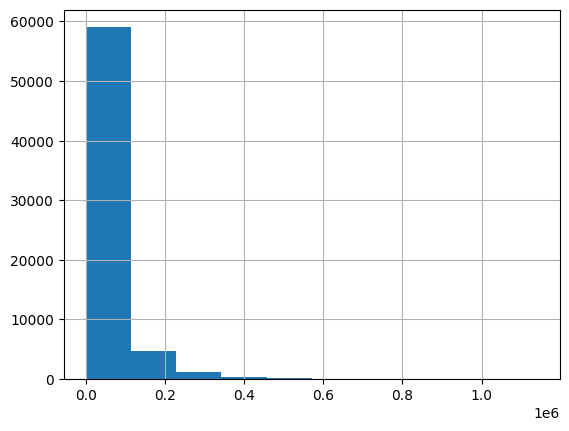
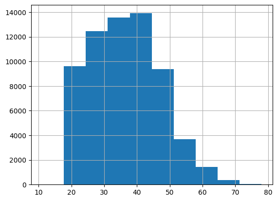
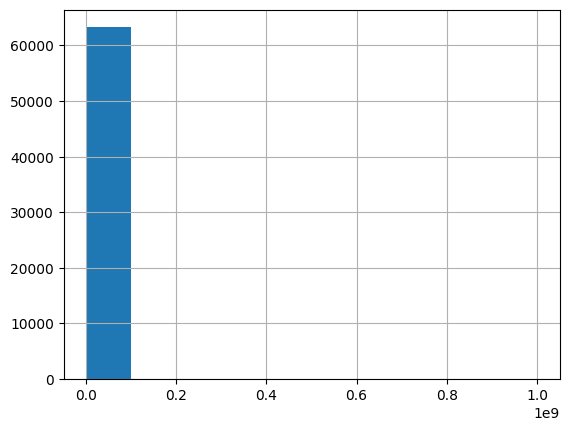
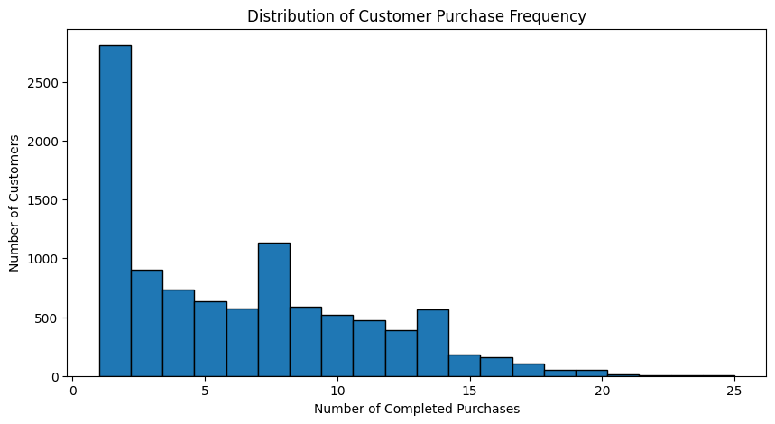
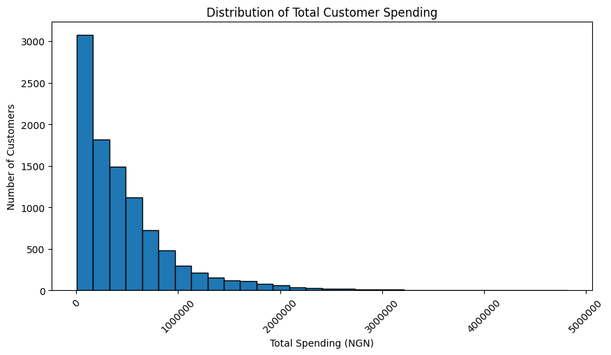
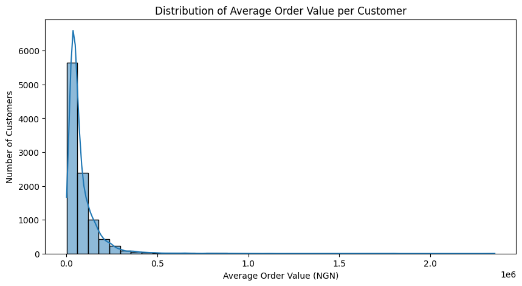
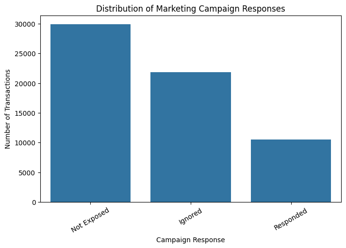

# CUSTOMER SEGMENTATION AND BEHAVIOURAL ANALYTICS

Table of Content
- Project Overview
- Data Understanding
- Data Preparation and Cleaning
- Exploratory Data Analysis (EDA)
- Customer-Level Feature Engineering
- Construction of the Final Customer-Level Dataset
- Feature Selection and Preprocessing
- Feature Transformation
- Feature Scaling
- Dimensionality Reduction (PCA)
- Customer Segmentation Using K-Means
- Customer Cluster Profiling
- Business Performance Analysis
- Business Insights and Recommendations
- Model Deployment and Application Development

## PROJECT OVERVIEW
**Project Description**

The Customer Segmentation and Behavioural Analytics project focuses on analysing customer demographics, purchasing patterns, spending behaviour, product preferences, and marketing engagement to identify distinct customer groups within an e-commerce retail business.

The project applies data analytics and unsupervised machine learning techniques, particularly Principal Component Analysis (PCA) and K-Means Clustering, to group customers based on similarities in their characteristics and purchasing behaviour.

The trained model is deployed through an interactive Streamlit application that supports individual and bulk customer segmentation, segment identification, business recommendations, visual summaries, and downloadable results.

**Project Background**

Understanding customer behaviour helps businesses improve marketing strategies, customer retention, and revenue generation. However, customers differ in their spending patterns, purchase frequency, product preferences, and marketing engagement.

This project uses historical customer and transaction data to uncover these behavioural differences, identify meaningful customer segments, and provide insights that support data-driven business decisions.

**Problem Statement**

Businesses often collect large volumes of customer data without an effective system for identifying distinct customer behaviours. Treating all customers similarly can lead to ineffective marketing campaigns, missed retention opportunities, and poor customer targeting.

This project addresses the challenge by developing a machine learning-based segmentation system that groups customers according to their demographic and purchasing characteristics and provides actionable business recommendations.

**Project Objectives**

The project aims to:
- Integrate and clean customer and transaction datasets.
- Perform exploratory data analysis to understand customer behaviour.
- Engineer customer-level features from transaction records.
- Select and preprocess relevant features for clustering.
- Apply PCA for dimensionality reduction.
- Implement K-Means clustering to identify customer segments.
- Evaluate and interpret the resulting clusters.
- Develop segment-specific business recommendations.
- Deploy the trained model using Streamlit for individual and bulk customer segmentation.

**Project Scope**

The project covers data integration, cleaning, exploratory data analysis, feature engineering, feature selection, dimensionality reduction, customer clustering, model evaluation, business interpretation, and deployment.

The analysis considers customer demographics, spending, purchase frequency, recency, product diversity, returns, discounts, marketing engagement, profitability, and sales channel behaviour.
The project focuses on historical behavioural segmentation and does not attempt to predict customer lifetime value or guarantee future purchasing behaviour.

**Tools and Technologies Used**
| Tool / Technology | Application |
|---|---|
| Python | Programming and analysis |
| Pandas and NumPy | Data manipulation and computation |
| Matplotlib and Seaborn | Data visualisation |
| Scikit-learn | Preprocessing, PCA, K-Means and evaluation |
| Joblib | Model serialization |
| Streamlit | Web application development |
| VS Code | Development environment |
| Git and GitHub | Version control and repository hosting |
| Streamlit Community Cloud | Application deployment |

## DATA UNDERSTANDING
**Dataset Overview**

The project uses two datasets representing customer demographic information and historical transaction records from an e-commerce retail business.

The first dataset (df1) contains customer information, while the second dataset (df2) contains transaction-level records. These datasets provide the foundation for analysing customer characteristics, purchasing behaviour, spending patterns, and engagement.

The initial dataset dimensions are presented below:
| Dataset | Description | Rows | Columns |
|---|---|---:|---:|
| df1 | Customer Demographics | 10,040 | 11 |
| df2 | Transaction Records | 65,889 | 15 |

**Dataset Structure and Variables**

The project consists of two datasets with different but complementary structures:
- Customer Dataset (df1): Contains customer-level demographic and profile information, with 11 variables.
- Transaction Dataset (df2): Contains individual transaction records and purchasing-related information, with 15 variables.

The customer dataset provides information about who the customers are, while the transaction dataset captures their purchasing activities and interactions with the business.

**Data Sources and File Structure**

The two datasets were loaded into separate Pandas DataFrames for independent inspection and subsequent processing:
- df1 – Customer demographic dataset.
- df2 – Transaction dataset.

Both datasets were retained separately at the initial stage to allow their structures, contents, and data quality to be examined before integration.

**Common Identifier and Data Integration**
The two datasets share a common identifier, customer_id, which serves as the linking key between customer records and their associated transactions.

This identifier provides the basis for combining customer demographic information with historical purchasing records to create a unified dataset for subsequent analysis.

**Data Understanding Summary**

The initial inspection established that the project contains 10,040 customer records and 65,889 transaction records across two datasets, with a combined total of 26 columns before integration.

Understanding the structure and relationship between these datasets provides the foundation for the next stage: Data Preparation and Cleaning.

**Data Dictionary**

A. Customers table – 11 columns
| Column | Data type | Description |
|---|---|---|
| customer_id | String | Unique customer identifier |
| age | Numeric | Customer's age |
| annual_income_ngn | Numeric | Estimated annual income in naira |
| region | Categorical | Customer's geographical region |
| city | Categorical | Customer's city |
| signup_date | Date | Customer registration date |
| acquisition_channel | Categorical | Original customer acquisition channel |
| membership_tier | Categorical | Standard, Silver, Gold or Platinum |
| preferred_contact_channel | Categorical | Preferred communication channel |
| marketing_consent | Categorical | Whether customer permits marketing |
| customer_satisfaction_score | Numeric | Customer satisfaction score (1–5) |

B. Transactions table – 15 columns
| Column | Data type | Description |
|---|---|---|
| transaction_id | String | Unique transaction identifier |
| customer_id | String | Customer foreign key |
| transaction_date | Date | Date of purchase |
| product_category | Categorical | Product category purchased |
| units | Integer | Quantity purchased |
| unit_price_ngn | Numeric | Price per unit |
| discount_pct | Numeric | Discount applied (0–1) |
| gross_amount_ngn | Numeric | Transaction amount before discount |
| net_amount_ngn | Numeric | Revenue after discount and returns |
| cost_amount_ngn | Numeric | Cost associated with the transaction |
| payment_method | Categorical | Payment method used |
| sales_channel | Categorical | Purchase channel |
| order_status | Categorical | Completed or returned |
| campaign_id | String | Associated marketing campaign |
| campaign_response | Categorical | Customer campaign response |

## DATA PREPARATION AND CLEANING
This stage involved preparing the customer and transaction datasets for analysis by removing duplicate records, integrating the datasets, inspecting data quality, correcting inconsistencies, and handling missing and abnormal values.

**Duplicate Record Identification and Removal**

Duplicate records were identified in both datasets using Pandas' duplicated() method. The detected duplicates were removed using drop_duplicates() to prevent repeated records from affecting subsequent analysis.

Python Implementation:
```Python
# Check and remove duplicates in customer dataset
df1.duplicated().sum()
df1.drop_duplicates(inplace=True)

# Check and remove duplicates in transaction dataset
df2.duplicated().sum()
df2.drop_duplicates(inplace=True)
```

Results:
| Dataset | Initial Records | Duplicates Removed | Remaining Records |
|---|---:|---:|---:|
| Customer (df1) | 10,040 | 40 | 10,000 |
| Transactions (df2) | 65,889 | 250 | 65,639 |
Conclusion: Duplicate records were successfully removed, leaving 10,000 customer records and 65,639 transaction records for further processing.

**Dataset Integration and Merging**

The cleaned customer and transaction datasets were merged using customer_id as the common identifier. A left join was applied, using the transaction dataset as the left table, to retain all transaction records while attaching their corresponding customer information.

Python Implementation:
```Python
df = pd.merge(
    df2,
    df1,
    on='customer_id',
    how='left'
)

print("Transactions shape:", df2.shape)
print("Customers shape:", df1.shape)
print("Merged dataset shape:", df.shape)
```

Results:
| Dataset | Rows | Columns |
|---|---:|---:|
| Transactions | 65,639 | 15 |
| Customers | 10,000 | 11 |
| Merged Dataset | 65,639 | 25 |
Conclusion: The merging operation produced a unified dataset containing 65,639 transaction records and 25 columns, combining transaction-level information with customer demographics.

**Data Inspection and Type Conversion**

The merged dataset was inspected to examine its columns, data types, and general structure. The transaction and signup date columns were converted to datetime format to support date-based operations and subsequent feature engineering.

Python Implementation:
```python
# Display dataset columns
for col in df.columns:
    print(col)

# Convert date columns
date_columns = [
    'transaction_date',
    'signup_date'
]

for col in date_columns:
    df[col] = pd.to_datetime(
        df[col],
        errors='coerce'
    )
```
Conclusion: The initial inspection established the structure of the merged dataset, while datetime conversion prepared the date variables for chronological analysis.

**Data Quality Assessment**

A column-by-column assessment was conducted to identify missing values, duplicates, inconsistent categories, and invalid numerical observations.
The inspection covered the following variables:
| Variable | Quality Checks Performed |
|---|---|
| transaction_id | Missing values and duplicates |
| customer_id | Missing values |
| transaction_date | Missing dates |
| product_category | Missing and inconsistent categories |
| units | Missing, negative and unusual values |
| unit_price_ngn | Missing and unreasonable prices |
| discount_pct | Missing, negative and above-range values |
| cost_amount_ngn | Missing and negative values |
| payment_method | Missing and unique categories |
| sales_channel | Missing and unique categories |
| order_status | Missing and inconsistent categories |
| campaign_id | Missing values |
| age | Missing and unreasonable ages |
| annual_income_ngn | Missing and negative values |
| region, city | Missing and inconsistent geographical values |
| signup_date | Missing dates |
| acquisition_channel | Missing and unique categories |
| membership_tier | Missing and unique categories |
| preferred_contact_channel | Missing and unique categories |
| marketing_consent | Missing and unique values |
| customer_satisfaction_score | Missing and out-of-range scores |

Conclusion: The assessment identified the variables requiring cleaning and established the basis for applying appropriate treatment methods according to their data types and distributions.

**Handling Missing and Inconsistent Values**

**Product Category**

Missing product categories were replaced with Unknown. Title casing and whitespace removal were also applied to standardise category labels.

Script:
```python
df['product_category'].fillna('Unknown', inplace=True)

df['product_category'] = (
    df['product_category']
    .apply(lambda x: x.title().strip())
)
```

**Units**

Negative unit values were treated as invalid and converted to missing values. A histogram was examined to understand the distribution, and the median was used for imputation because the distribution was skewed.

Script:
```python
df.loc[df['units'] < 0, 'units'] = np.nan

# Replace missing values with median
df['units'].fillna(
    df['units'].median(),
    inplace=True
)
```

Distribution of Units Before Median Imputation


**Unit Price**

Unit prices were examined using descriptive statistics and a histogram. To identify unusual observations, category-specific Interquartile Range (IQR) boundaries were calculated, allowing prices to be assessed relative to their respective product categories.

Script:
```python
price_bounds = (
    df.groupby('product_category')['unit_price_ngn']
    .agg(
        Q1=lambda x: x.quantile(0.25),
        Q3=lambda x: x.quantile(0.75)
    )
)

price_bounds['IQR'] = (
    price_bounds['Q3'] - price_bounds['Q1']
)

price_bounds['lower_bound'] = (
    price_bounds['Q1'] - 1.5 * price_bounds['IQR']
)

price_bounds['upper_bound'] = (
    price_bounds['Q3'] + 1.5 * price_bounds['IQR']
)
```

The calculated boundaries were mapped to the original dataset, and observations outside the category-specific boundaries were flagged for further investigation.
After examining the flagged transactions, 15 records containing an extreme unit price of ₦75,000,000 were identified as confirmed price errors. These values were replaced with missing values and subsequently imputed using the median unit price.

Script:
```python
# Identify confirmed price errors
extreme_price_mask = (
    df['unit_price_ngn'].eq(75_000_000)
)

# Preserve an audit flag
df['confirmed_price_error'] = extreme_price_mask

# Replace erroneous values
df.loc[
    extreme_price_mask,
    'unit_price_ngn'
] = np.nan

# Median imputation
df['unit_price_ngn'].fillna(
    df['unit_price_ngn'].median(),
    inplace=True
)
```

Distribution of Unit Prices Before Outlier Treatment


Distribution of Unit Prices After Outlier Treatment and Imputation



Conclusion: Category-specific IQR boundaries helped identify unusual prices for investigation. Confirmed erroneous values were treated separately from other flagged observations to avoid automatically removing legitimate high-priced transactions.

**Discount Percentage**

Discount values greater than 1 were treated as invalid and converted to missing values. The median was subsequently used to replace missing observations.

Script:
```python
df.loc[
    df['discount_pct'] > 1,
    'discount_pct'
] = np.nan

df['discount_pct'].fillna(
    df['discount_pct'].median(),
    inplace=True
)
```

Distribution of Discount Percentage


**Payment Method**

Missing payment method entries were replaced with Unknown to preserve transaction records without assigning unsupported payment categories.

Script:
```python
df['payment_method'].fillna(
    'Unknown',
    inplace=True
)
```

**Order Status**

Inconsistent formatting in the order status column was standardised using title casing and whitespace removal.

Script:
```python
df['order_status'] = (
    df['order_status']
    .apply(lambda x: x.title().strip())
)
```

**Age**

Age values below 10 and above 100 were treated as invalid and converted to missing values. The resulting missing observations were replaced using the median age.

Script:
```python
df.loc[df['age'] < 10, 'age'] = np.nan
df.loc[df['age'] > 100, 'age'] = np.nan

df['age'].fillna(
    df['age'].median(),
    inplace=True
)
```

Distribution of Customer Age



**Annual Income**

The annual income distribution was examined, and missing values were replaced with the median to reduce the influence of extreme observations on imputation.

Script:
```python
df['annual_income_ngn'].fillna(
    df['annual_income_ngn'].median(),
    inplace=True
)
```

Distribution of Annual Income



**Region and City**

Region values were standardised using title casing and whitespace removal, while missing city entries were replaced with Unknown.

Script:
```python
df['region'] = (
    df['region']
    .apply(lambda x: x.title().strip())
)

df['city'].fillna(
    'Unknown',
    inplace=True
)
```

**Customer Satisfaction Score**

Missing satisfaction scores were replaced using the median score after examining the distribution of the variable.

Script:
```
df['customer_satisfaction_score'].fillna(
    df['customer_satisfaction_score'].median(),
    inplace=True
)
```

Distribution of Customer Satisfaction Scores


**Validation of Calculated Columns**

The gross and net transaction amounts were recalculated to ensure consistency between the transaction quantities, unit prices, and discount percentages.
Gross amount was calculated as the product of units purchased and unit price, while net amount was obtained by deducting the applicable discount from the gross amount.

Python Implementation:
```python
Gross Amount
# Gross Amount = Units × Unit Price
df['gross_amount_ngn'] = (
    df['units'] * df['unit_price_ngn']
)

Net Amount
# Net Amount = Gross Amount - Discount Amount
df['net_amount_ngn'] = (
    df['gross_amount_ngn'] -
    (df['gross_amount_ngn'] * df['discount_pct'])
)
```

Conclusion: The calculated columns were regenerated using the cleaned transaction variables to ensure that gross and net amounts reflected the corrected units, unit prices, and discount percentages. These variables provide the foundation for subsequent customer spending, revenue, and profitability analysis.

**Final Missing Value Assessment**

After applying the cleaning and imputation procedures, the dataset was checked again to examine the remaining missing values.

Python Implementation:
```python
df.isna().sum()
```

## EXPLORATORY DATA ANALYSIS (EDA)

Exploratory Data Analysis was performed to understand customer demographics, purchasing patterns, spending behaviour, product preferences, sales channel usage, and marketing engagement. The analysis focused on identifying patterns and trends that could inform customer-level feature engineering and subsequent segmentation.

**Purchasing Behaviour Analysis**

Business Question: How frequently do customers make purchases, and how does purchasing activity vary across customers?

The order status distribution was examined to distinguish completed transactions from returned transactions. Only completed transactions were retained for the purchasing behaviour analysis to ensure that purchase frequency reflected successful purchases.

Python Implementation:
```python
# Examine transaction order statuses
df['order_status'].value_counts(dropna=False)

# Filter completed transactions
completed_df = df[
    df['order_status'] == 'Completed'
].copy()
```

Results:
| Order Status | Transaction Count |
|---|---:|
| Completed | 62,271 |
| Returned | 3,368 |
| **Total** | **65,639** |

The completed transactions were used to calculate the number of unique completed purchases made by each customer.

```python
# Calculate purchase frequency per customer
purchase_frequency = (
    completed_df.groupby('customer_id')['transaction_id']
    .nunique()
    .reset_index(name='purchase_frequency')
)

# Descriptive statistics
purchase_frequency['purchase_frequency'].describe()
```

Results:
| Statistic | Purchase Frequency |
|---|---:|
| Customers | 9,912 |
| Mean | 6.28 |
| Standard Deviation | 4.64 |
| Minimum | 1 |
| 25th Percentile | 2 |
| Median | 5 |
| 75th Percentile | 10 |
| Maximum | 25 |

Interpretation: The analysis shows that customers made an average of approximately 6 completed purchases, with a median of 5 purchases. Purchase frequency ranged from 1 to 25 transactions, indicating considerable variation in purchasing activity across the customer base.



**Customer Spending Behaviour**

Business Question: How much does each customer spend, and how does spending vary across the customer base?

Total customer spending was calculated by aggregating the net transaction amounts of completed purchases for each customer.

Python Implementation:
```python
# Calculate total spending per customer
customer_spending = (
    completed_df.groupby('customer_id')['net_amount_ngn']
    .sum()
    .reset_index(name='total_spending_ngn')
)

# Descriptive statistics
customer_spending['total_spending_ngn'].describe()
```

Results:
| Statistic | Total Spending (NGN) |
|---|---:|
| Customers | 9,912 |
| Mean | 471,104.70 |
| Standard Deviation | 500,038.30 |
| Minimum | 1,945.04 |
| 25th Percentile | 119,622.30 |
| Median | 329,314.10 |
| 75th Percentile | 630,604.30 |
| Maximum | 4,824,470.00 |

Interpretation: Customers spent an average of approximately ₦471,104.70, while the median spending was ₦329,314.10. The difference between the mean and median suggests a positively skewed spending distribution, indicating that some customers spent considerably more than others.



**Average Order Value (AOV)**

Business Question: How much does a customer spend, on average, per completed transaction?

Average Order Value was calculated as the mean net transaction amount for each customer.

Python Implementation:
```python
# Calculate average order value per customer
customer_aov = (
    completed_df.groupby('customer_id')['net_amount_ngn']
    .mean()
    .reset_index(name='average_order_value_ngn')
)

# Descriptive statistics
customer_aov['average_order_value_ngn'].describe()
```

Results:
| Statistic | Average Order Value (NGN) |
|---|---:|
| Customers | 9,912 |
| Mean | 81,538.92 |
| Standard Deviation | 92,131.28 |
| Minimum | 1,945.04 |
| 25th Percentile | 34,002.21 |
| Median | 53,481.84 |
| 75th Percentile | 98,915.99 |
| Maximum | 2,354,502.00 |

Interpretation: The average customer order value was approximately ₦81,538.92, while the median was ₦53,481.84. This indicates variation in transaction values, with some customers making considerably higher-value purchases than others.



**Purchasing Recency Analysis**

Business Question: How recently did each customer make a purchase?

Customer recency was calculated by determining the number of days between each customer's most recent completed transaction and the latest transaction date in the dataset.

Python Implementation:
```python
# Get the latest transaction date
snapshot_date = completed_df['transaction_date'].max()

# Calculate each customer's most recent purchase date
last_purchase = (
    completed_df.groupby('customer_id')['transaction_date']
    .max()
    .reset_index(name='last_purchase_date')
)

# Calculate recency in days
last_purchase['recency_days'] = (
    snapshot_date - last_purchase['last_purchase_date']
).dt.days
```

Results:
| Statistic | Recency (Days) |
|---|---:|
| Customers | 9,912 |
| Mean | 160.79 |
| Standard Deviation | 172.84 |
| Minimum | 0 |
| 25th Percentile | 46 |
| Median | 97 |
| 75th Percentile | 208 |
| Maximum | 1,173 |

Interpretation: The average purchase recency was approximately 161 days, while the median was 97 days. This indicates that customers differed considerably in how recently they had purchased. Some customers purchased on the latest transaction date, while others had much longer periods since their last recorded purchase.

Note: Recency is measured relative to the latest transaction date in the dataset, not the current date.


**Product Preference Analysis**

Business Question: Which product categories do customers purchase most frequently?

The distribution of completed transactions across product categories was examined to identify the most frequently purchased categories and understand customer product preferences.

Python Implementation:
```python
# Calculate category purchase frequency
category_purchases = (
    completed_df.groupby('product_category')['transaction_id']
    .nunique()
    .reset_index(name='purchase_count')
    .sort_values('purchase_count', ascending=False)
)

# Calculate purchase percentages
category_purchases['purchase_percentage'] = (
    category_purchases['purchase_count']
    / category_purchases['purchase_count'].sum()
) * 100
```

Results:
| Product Category | Purchase Count | Percentage |
|---|---:|---:|
| Fashion | 13,713 | 22.02% |
| Groceries | 12,393 | 19.90% |
| Electronics | 11,203 | 17.99% |
| Home & Living | 10,034 | 16.11% |
| Beauty | 8,521 | 13.68% |
| Sports | 6,030 | 9.68% |
| Unknown | 377 | 0.61% |

Interpretation: Fashion recorded the highest number of completed purchases, accounting for approximately 22.02% of all purchases, followed by Groceries and Electronics. Sports recorded the lowest known product category purchase count. These findings indicate differences in customer demand across product categories.


**Sales Channel Behaviour Analysis**

Business Question: Which sales channels do customers use most frequently to make purchases?

Completed transactions were grouped by sales channel to examine customer purchasing preferences across the available channels.

Python Implementation:
```python
# Examine sales channel distribution
channel_purchases = (
    completed_df['sales_channel']
    .value_counts()
    .reset_index()
)

channel_purchases.columns = [
    'sales_channel',
    'purchase_count'
]

# Calculate purchase percentages
channel_purchases['purchase_percentage'] = (
    channel_purchases['purchase_count']
    / channel_purchases['purchase_count'].sum()
) * 100
```

Results:
| Sales Channel | Purchase Count | Percentage |
|---|---:|---:|
| Mobile App | 21,158 | 33.98% |
| Website | 17,368 | 27.89% |
| In-store | 15,631 | 25.10% |
| Marketplace | 8,114 | 13.03% |

Interpretation: The Mobile App was the most frequently used sales channel, accounting for approximately 33.98% of completed purchases. The Website and In-store channels followed, while Marketplace recorded the lowest transaction share. This suggests that digital channels, particularly the Mobile App, play an important role in customer purchasing activities.


**Marketing Behaviour Analysis**

Business Question: How do customers respond to the company's marketing campaigns?

The distribution of campaign responses among completed transactions was examined to understand the level of customer engagement with the company's marketing activities.

Python Implementation:
```python
# Examine campaign response distribution
campaign_response = (
    completed_df['campaign_response']
    .value_counts()
    .reset_index()
)

campaign_response.columns = [
    'campaign_response',
    'response_count'
]

# Calculate response percentages
campaign_response['response_percentage'] = (
    campaign_response['response_count']
    / campaign_response['response_count'].sum()
) * 100
```

Results:
| Campaign Response | Transaction Count | Percentage |
|---|---:|---:|
| Not Exposed | 29,920 | 48.05% |
| Ignored | 21,811 | 35.03% |
| Responded | 10,540 | 16.93% |

Interpretation: Approximately 16.93% of completed transactions were associated with customers who responded to marketing campaigns, while 35.03% were associated with ignored campaigns. The remaining 48.05% were classified as not exposed. This highlights differences in recorded campaign engagement across transactions.



**Customer Demographics Analysis**

Business Question: What are the demographic characteristics of the company's customers?

The customer demographic dataset was constructed by retaining one record per unique customer. Age, annual income, membership tier, and geographical distribution were examined to understand the composition of the customer base.

Python Implementation:
```python
# Create customer-level demographic dataset
customer_demographics = (
    df.drop_duplicates(subset='customer_id').copy()
)

Age Distribution
The age distribution was examined using descriptive statistics, a histogram, and a boxplot\
# Descriptive statistics
customer_demographics['age'].describe()
```

Results:
| Statistic | Age |
|---|---:|
| Customers | 10,000 |
| Mean | 36.36 |
| Standard Deviation | 10.54 |
| Minimum | 11 |
| 25th Percentile | 29 |
| Median | 36 |
| 75th Percentile | 43 |
| Maximum | 78 |

Interpretation: The customer base had an average age of approximately 36 years, with a median of 36 years. Most customers were concentrated between the ages of 29 and 43, indicating a relatively young to middle-aged customer population.


