# CUSTOMER SEGMENTATION AND BEHAVIOURAL ANALYTICS

Table of Content
- Project Overview
- Data Understanding
- Data Preparation and Cleaning
- Exploratory Data Analysis (EDA)
- Customer-Level Feature Engineering
- Construction of the Final Customer-Level Dataset
- Feature Selection and Preprocessing
- Feature Transformation
- Feature Scaling
- Dimensionality Reduction (PCA)
- Customer Segmentation Using K-Means
- Customer Cluster Profiling
- Business Performance Analysis
- Business Insights and Recommendations
- Model Deployment and Application Development

## PROJECT OVERVIEW
**Project Description**

The Customer Segmentation and Behavioural Analytics project focuses on analysing customer demographics, purchasing patterns, spending behaviour, product preferences, and marketing engagement to identify distinct customer groups within an e-commerce retail business.

The project applies data analytics and unsupervised machine learning techniques, particularly Principal Component Analysis (PCA) and K-Means Clustering, to group customers based on similarities in their characteristics and purchasing behaviour.

The trained model is deployed through an interactive Streamlit application that supports individual and bulk customer segmentation, segment identification, business recommendations, visual summaries, and downloadable results.

**Project Background**

Understanding customer behaviour helps businesses improve marketing strategies, customer retention, and revenue generation. However, customers differ in their spending patterns, purchase frequency, product preferences, and marketing engagement.

This project uses historical customer and transaction data to uncover these behavioural differences, identify meaningful customer segments, and provide insights that support data-driven business decisions.

**Problem Statement**

Businesses often collect large volumes of customer data without an effective system for identifying distinct customer behaviours. Treating all customers similarly can lead to ineffective marketing campaigns, missed retention opportunities, and poor customer targeting.

This project addresses the challenge by developing a machine learning-based segmentation system that groups customers according to their demographic and purchasing characteristics and provides actionable business recommendations.

**Project Objectives**

The project aims to:
- Integrate and clean customer and transaction datasets.
- Perform exploratory data analysis to understand customer behaviour.
- Engineer customer-level features from transaction records.
- Select and preprocess relevant features for clustering.
- Apply PCA for dimensionality reduction.
- Implement K-Means clustering to identify customer segments.
- Evaluate and interpret the resulting clusters.
- Develop segment-specific business recommendations.
- Deploy the trained model using Streamlit for individual and bulk customer segmentation.

**Project Scope**

The project covers data integration, cleaning, exploratory data analysis, feature engineering, feature selection, dimensionality reduction, customer clustering, model evaluation, business interpretation, and deployment.

The analysis considers customer demographics, spending, purchase frequency, recency, product diversity, returns, discounts, marketing engagement, profitability, and sales channel behaviour.
The project focuses on historical behavioural segmentation and does not attempt to predict customer lifetime value or guarantee future purchasing behaviour.

**Tools and Technologies Used**
| Tool / Technology | Application |
|---|---|
| Python | Programming and analysis |
| Pandas and NumPy | Data manipulation and computation |
| Matplotlib and Seaborn | Data visualisation |
| Scikit-learn | Preprocessing, PCA, K-Means and evaluation |
| Joblib | Model serialization |
| Streamlit | Web application development |
| VS Code | Development environment |
| Git and GitHub | Version control and repository hosting |
| Streamlit Community Cloud | Application deployment |

## DATA UNDERSTANDING
**Dataset Overview**

The project uses two datasets representing customer demographic information and historical transaction records from an e-commerce retail business.

The first dataset (df1) contains customer information, while the second dataset (df2) contains transaction-level records. These datasets provide the foundation for analysing customer characteristics, purchasing behaviour, spending patterns, and engagement.

The initial dataset dimensions are presented below:
| Dataset | Description | Rows | Columns |
|---|---|---:|---:|
| df1 | Customer Demographics | 10,040 | 11 |
| df2 | Transaction Records | 65,889 | 15 |

**Dataset Structure and Variables**

The project consists of two datasets with different but complementary structures:
- Customer Dataset (df1): Contains customer-level demographic and profile information, with 11 variables.
- Transaction Dataset (df2): Contains individual transaction records and purchasing-related information, with 15 variables.

The customer dataset provides information about who the customers are, while the transaction dataset captures their purchasing activities and interactions with the business.

**Data Sources and File Structure**

The two datasets were loaded into separate Pandas DataFrames for independent inspection and subsequent processing:
- df1 – Customer demographic dataset.
- df2 – Transaction dataset.

Both datasets were retained separately at the initial stage to allow their structures, contents, and data quality to be examined before integration.

**Common Identifier and Data Integration**
The two datasets share a common identifier, customer_id, which serves as the linking key between customer records and their associated transactions.

This identifier provides the basis for combining customer demographic information with historical purchasing records to create a unified dataset for subsequent analysis.

**Data Understanding Summary**

The initial inspection established that the project contains 10,040 customer records and 65,889 transaction records across two datasets, with a combined total of 26 columns before integration.

Understanding the structure and relationship between these datasets provides the foundation for the next stage: Data Preparation and Cleaning.

**Data Dictionary**

A. Customers table – 11 columns
| Column | Data type | Description |
|---|---|---|
| customer_id | String | Unique customer identifier |
| age | Numeric | Customer's age |
| annual_income_ngn | Numeric | Estimated annual income in naira |
| region | Categorical | Customer's geographical region |
| city | Categorical | Customer's city |
| signup_date | Date | Customer registration date |
| acquisition_channel | Categorical | Original customer acquisition channel |
| membership_tier | Categorical | Standard, Silver, Gold or Platinum |
| preferred_contact_channel | Categorical | Preferred communication channel |
| marketing_consent | Categorical | Whether customer permits marketing |
| customer_satisfaction_score | Numeric | Customer satisfaction score (1–5) |

B. Transactions table – 15 columns
| Column | Data type | Description |
|---|---|---|
| transaction_id | String | Unique transaction identifier |
| customer_id | String | Customer foreign key |
| transaction_date | Date | Date of purchase |
| product_category | Categorical | Product category purchased |
| units | Integer | Quantity purchased |
| unit_price_ngn | Numeric | Price per unit |
| discount_pct | Numeric | Discount applied (0–1) |
| gross_amount_ngn | Numeric | Transaction amount before discount |
| net_amount_ngn | Numeric | Revenue after discount and returns |
| cost_amount_ngn | Numeric | Cost associated with the transaction |
| payment_method | Categorical | Payment method used |
| sales_channel | Categorical | Purchase channel |
| order_status | Categorical | Completed or returned |
| campaign_id | String | Associated marketing campaign |
| campaign_response | Categorical | Customer campaign response |

## DATA PREPARATION AND CLEANING
This stage involved preparing the customer and transaction datasets for analysis by removing duplicate records, integrating the datasets, inspecting data quality, correcting inconsistencies, and handling missing and abnormal values.

**Duplicate Record Identification and Removal**

Duplicate records were identified in both datasets using Pandas' duplicated() method. The detected duplicates were removed using drop_duplicates() to prevent repeated records from affecting subsequent analysis.

Python Implementation:
```Python
# Check and remove duplicates in customer dataset
df1.duplicated().sum()
df1.drop_duplicates(inplace=True)

# Check and remove duplicates in transaction dataset
df2.duplicated().sum()
df2.drop_duplicates(inplace=True)
```

Results:
| Dataset | Initial Records | Duplicates Removed | Remaining Records |
|---|---:|---:|---:|
| Customer (df1) | 10,040 | 40 | 10,000 |
| Transactions (df2) | 65,889 | 250 | 65,639 |
Conclusion: Duplicate records were successfully removed, leaving 10,000 customer records and 65,639 transaction records for further processing.

**Dataset Integration and Merging**

The cleaned customer and transaction datasets were merged using customer_id as the common identifier. A left join was applied, using the transaction dataset as the left table, to retain all transaction records while attaching their corresponding customer information.

Python Implementation:
```Python
df = pd.merge(
    df2,
    df1,
    on='customer_id',
    how='left'
)

print("Transactions shape:", df2.shape)
print("Customers shape:", df1.shape)
print("Merged dataset shape:", df.shape)
```

Results:
| Dataset | Rows | Columns |
|---|---:|---:|
| Transactions | 65,639 | 15 |
| Customers | 10,000 | 11 |
| Merged Dataset | 65,639 | 25 |
Conclusion: The merging operation produced a unified dataset containing 65,639 transaction records and 25 columns, combining transaction-level information with customer demographics.

**Data Inspection and Type Conversion**

The merged dataset was inspected to examine its columns, data types, and general structure. The transaction and signup date columns were converted to datetime format to support date-based operations and subsequent feature engineering.

Python Implementation:
```python
# Display dataset columns
for col in df.columns:
    print(col)

# Convert date columns
date_columns = [
    'transaction_date',
    'signup_date'
]

for col in date_columns:
    df[col] = pd.to_datetime(
        df[col],
        errors='coerce'
    )
```
Conclusion: The initial inspection established the structure of the merged dataset, while datetime conversion prepared the date variables for chronological analysis.

**Data Quality Assessment**

A column-by-column assessment was conducted to identify missing values, duplicates, inconsistent categories, and invalid numerical observations.
The inspection covered the following variables:
| Variable | Quality Checks Performed |
|---|---|
| transaction_id | Missing values and duplicates |
| customer_id | Missing values |
| transaction_date | Missing dates |
| product_category | Missing and inconsistent categories |
| units | Missing, negative and unusual values |
| unit_price_ngn | Missing and unreasonable prices |
| discount_pct | Missing, negative and above-range values |
| cost_amount_ngn | Missing and negative values |
| payment_method | Missing and unique categories |
| sales_channel | Missing and unique categories |
| order_status | Missing and inconsistent categories |
| campaign_id | Missing values |
| age | Missing and unreasonable ages |
| annual_income_ngn | Missing and negative values |
| region, city | Missing and inconsistent geographical values |
| signup_date | Missing dates |
| acquisition_channel | Missing and unique categories |
| membership_tier | Missing and unique categories |
| preferred_contact_channel | Missing and unique categories |
| marketing_consent | Missing and unique values |
| customer_satisfaction_score | Missing and out-of-range scores |

Conclusion: The assessment identified the variables requiring cleaning and established the basis for applying appropriate treatment methods according to their data types and distributions.

**Handling Missing and Inconsistent Values**

**Product Category**

Missing product categories were replaced with Unknown. Title casing and whitespace removal were also applied to standardise category labels.

Script:
```python
df['product_category'].fillna('Unknown', inplace=True)

df['product_category'] = (
    df['product_category']
    .apply(lambda x: x.title().strip())
)
```

**Units**

Negative unit values were treated as invalid and converted to missing values. A histogram was examined to understand the distribution, and the median was used for imputation because the distribution was skewed.

Script:
```python
df.loc[df['units'] < 0, 'units'] = np.nan

# Replace missing values with median
df['units'].fillna(
    df['units'].median(),
    inplace=True
)
```

Distribution of Units Before Median Imputation

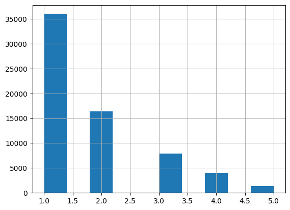

**Unit Price**

Unit prices were examined using descriptive statistics and a histogram. To identify unusual observations, category-specific Interquartile Range (IQR) boundaries were calculated, allowing prices to be assessed relative to their respective product categories.

Script:
```python
price_bounds = (
    df.groupby('product_category')['unit_price_ngn']
    .agg(
        Q1=lambda x: x.quantile(0.25),
        Q3=lambda x: x.quantile(0.75)
    )
)

price_bounds['IQR'] = (
    price_bounds['Q3'] - price_bounds['Q1']
)

price_bounds['lower_bound'] = (
    price_bounds['Q1'] - 1.5 * price_bounds['IQR']
)

price_bounds['upper_bound'] = (
    price_bounds['Q3'] + 1.5 * price_bounds['IQR']
)
```

The calculated boundaries were mapped to the original dataset, and observations outside the category-specific boundaries were flagged for further investigation.
After examining the flagged transactions, 15 records containing an extreme unit price of ₦75,000,000 were identified as confirmed price errors. These values were replaced with missing values and subsequently imputed using the median unit price.

Script:
```python
# Identify confirmed price errors
extreme_price_mask = (
    df['unit_price_ngn'].eq(75_000_000)
)

# Preserve an audit flag
df['confirmed_price_error'] = extreme_price_mask

# Replace erroneous values
df.loc[
    extreme_price_mask,
    'unit_price_ngn'
] = np.nan

# Median imputation
df['unit_price_ngn'].fillna(
    df['unit_price_ngn'].median(),
    inplace=True
)
```

Distribution of Unit Prices Before Outlier Treatment

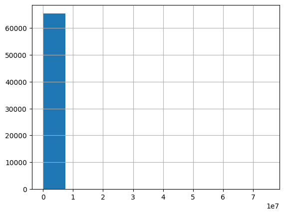

Distribution of Unit Prices After Outlier Treatment and Imputation


Conclusion: Category-specific IQR boundaries helped identify unusual prices for investigation. Confirmed erroneous values were treated separately from other flagged observations to avoid automatically removing legitimate high-priced transactions.

**Discount Percentage**

Discount values greater than 1 were treated as invalid and converted to missing values. The median was subsequently used to replace missing observations.

Script:
```python
df.loc[
    df['discount_pct'] > 1,
    'discount_pct'
] = np.nan

df['discount_pct'].fillna(
    df['discount_pct'].median(),
    inplace=True
)
```

Distribution of Discount Percentage

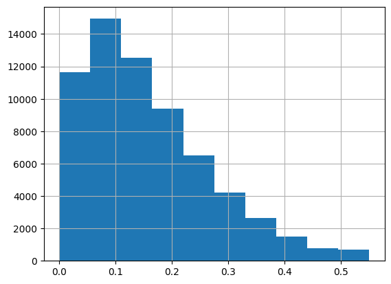

**Payment Method**

Missing payment method entries were replaced with Unknown to preserve transaction records without assigning unsupported payment categories.

Script:
```python
df['payment_method'].fillna(
    'Unknown',
    inplace=True
)
```

**Order Status**

Inconsistent formatting in the order status column was standardised using title casing and whitespace removal.

Script:
```python
df['order_status'] = (
    df['order_status']
    .apply(lambda x: x.title().strip())
)
```

**Age**

Age values below 10 and above 100 were treated as invalid and converted to missing values. The resulting missing observations were replaced using the median age.

Script:
```python
df.loc[df['age'] < 10, 'age'] = np.nan
df.loc[df['age'] > 100, 'age'] = np.nan

df['age'].fillna(
    df['age'].median(),
    inplace=True
)
```

Distribution of Customer Age


**Annual Income**

The annual income distribution was examined, and missing values were replaced with the median to reduce the influence of extreme observations on imputation.

Script:
```python
df['annual_income_ngn'].fillna(
    df['annual_income_ngn'].median(),
    inplace=True
)
```

Distribution of Annual Income


**Region and City**

Region values were standardised using title casing and whitespace removal, while missing city entries were replaced with Unknown.

Script:
```python
df['region'] = (
    df['region']
    .apply(lambda x: x.title().strip())
)

df['city'].fillna(
    'Unknown',
    inplace=True
)
```

**Customer Satisfaction Score**

Missing satisfaction scores were replaced using the median score after examining the distribution of the variable.

Script:
```
df['customer_satisfaction_score'].fillna(
    df['customer_satisfaction_score'].median(),
    inplace=True
)
```

Distribution of Customer Satisfaction Scores

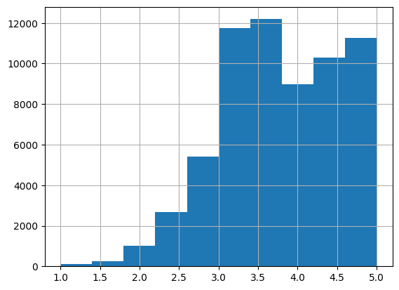

**Validation of Calculated Columns**

The gross and net transaction amounts were recalculated to ensure consistency between the transaction quantities, unit prices, and discount percentages.
Gross amount was calculated as the product of units purchased and unit price, while net amount was obtained by deducting the applicable discount from the gross amount.

Python Implementation:
```python
Gross Amount
# Gross Amount = Units × Unit Price
df['gross_amount_ngn'] = (
    df['units'] * df['unit_price_ngn']
)

Net Amount
# Net Amount = Gross Amount - Discount Amount
df['net_amount_ngn'] = (
    df['gross_amount_ngn'] -
    (df['gross_amount_ngn'] * df['discount_pct'])
)
```

Conclusion: The calculated columns were regenerated using the cleaned transaction variables to ensure that gross and net amounts reflected the corrected units, unit prices, and discount percentages. These variables provide the foundation for subsequent customer spending, revenue, and profitability analysis.

**Final Missing Value Assessment**

After applying the cleaning and imputation procedures, the dataset was checked again to examine the remaining missing values.

Python Implementation:
```python
df.isna().sum()
```

## EXPLORATORY DATA ANALYSIS (EDA)

Exploratory Data Analysis was performed to understand customer demographics, purchasing patterns, spending behaviour, product preferences, sales channel usage, and marketing engagement. The analysis focused on identifying patterns and trends that could inform customer-level feature engineering and subsequent segmentation.

**Purchasing Behaviour Analysis**

Business Question: How frequently do customers make purchases, and how does purchasing activity vary across customers?

The order status distribution was examined to distinguish completed transactions from returned transactions. Only completed transactions were retained for the purchasing behaviour analysis to ensure that purchase frequency reflected successful purchases.

Python Implementation:
```python
# Examine transaction order statuses
df['order_status'].value_counts(dropna=False)

# Filter completed transactions
completed_df = df[
    df['order_status'] == 'Completed'
].copy()
```

Results:
| Order Status | Transaction Count |
|---|---:|
| Completed | 62,271 |
| Returned | 3,368 |
| **Total** | **65,639** |

The completed transactions were used to calculate the number of unique completed purchases made by each customer.

```python
# Calculate purchase frequency per customer
purchase_frequency = (
    completed_df.groupby('customer_id')['transaction_id']
    .nunique()
    .reset_index(name='purchase_frequency')
)

# Descriptive statistics
purchase_frequency['purchase_frequency'].describe()
```

Results:
| Statistic | Purchase Frequency |
|---|---:|
| Customers | 9,912 |
| Mean | 6.28 |
| Standard Deviation | 4.64 |
| Minimum | 1 |
| 25th Percentile | 2 |
| Median | 5 |
| 75th Percentile | 10 |
| Maximum | 25 |

Interpretation: The analysis shows that customers made an average of approximately 6 completed purchases, with a median of 5 purchases. Purchase frequency ranged from 1 to 25 transactions, indicating considerable variation in purchasing activity across the customer base.


**Customer Spending Behaviour**

Business Question: How much does each customer spend, and how does spending vary across the customer base?

Total customer spending was calculated by aggregating the net transaction amounts of completed purchases for each customer.

Python Implementation:
```python
# Calculate total spending per customer
customer_spending = (
    completed_df.groupby('customer_id')['net_amount_ngn']
    .sum()
    .reset_index(name='total_spending_ngn')
)

# Descriptive statistics
customer_spending['total_spending_ngn'].describe()
```

Results:
| Statistic | Total Spending (NGN) |
|---|---:|
| Customers | 9,912 |
| Mean | 471,104.70 |
| Standard Deviation | 500,038.30 |
| Minimum | 1,945.04 |
| 25th Percentile | 119,622.30 |
| Median | 329,314.10 |
| 75th Percentile | 630,604.30 |
| Maximum | 4,824,470.00 |

Interpretation: Customers spent an average of approximately ₦471,104.70, while the median spending was ₦329,314.10. The difference between the mean and median suggests a positively skewed spending distribution, indicating that some customers spent considerably more than others.


**Average Order Value (AOV)**

Business Question: How much does a customer spend, on average, per completed transaction?

Average Order Value was calculated as the mean net transaction amount for each customer.

Python Implementation:
```python
# Calculate average order value per customer
customer_aov = (
    completed_df.groupby('customer_id')['net_amount_ngn']
    .mean()
    .reset_index(name='average_order_value_ngn')
)

# Descriptive statistics
customer_aov['average_order_value_ngn'].describe()
```

Results:
| Statistic | Average Order Value (NGN) |
|---|---:|
| Customers | 9,912 |
| Mean | 81,538.92 |
| Standard Deviation | 92,131.28 |
| Minimum | 1,945.04 |
| 25th Percentile | 34,002.21 |
| Median | 53,481.84 |
| 75th Percentile | 98,915.99 |
| Maximum | 2,354,502.00 |

Interpretation: The average customer order value was approximately ₦81,538.92, while the median was ₦53,481.84. This indicates variation in transaction values, with some customers making considerably higher-value purchases than others.


**Purchasing Recency Analysis**

Business Question: How recently did each customer make a purchase?

Customer recency was calculated by determining the number of days between each customer's most recent completed transaction and the latest transaction date in the dataset.

Python Implementation:
```python
# Get the latest transaction date
snapshot_date = completed_df['transaction_date'].max()

# Calculate each customer's most recent purchase date
last_purchase = (
    completed_df.groupby('customer_id')['transaction_date']
    .max()
    .reset_index(name='last_purchase_date')
)

# Calculate recency in days
last_purchase['recency_days'] = (
    snapshot_date - last_purchase['last_purchase_date']
).dt.days
```

Results:
| Statistic | Recency (Days) |
|---|---:|
| Customers | 9,912 |
| Mean | 160.79 |
| Standard Deviation | 172.84 |
| Minimum | 0 |
| 25th Percentile | 46 |
| Median | 97 |
| 75th Percentile | 208 |
| Maximum | 1,173 |

Interpretation: The average purchase recency was approximately 161 days, while the median was 97 days. This indicates that customers differed considerably in how recently they had purchased. Some customers purchased on the latest transaction date, while others had much longer periods since their last recorded purchase.

Note: Recency is measured relative to the latest transaction date in the dataset, not the current date.

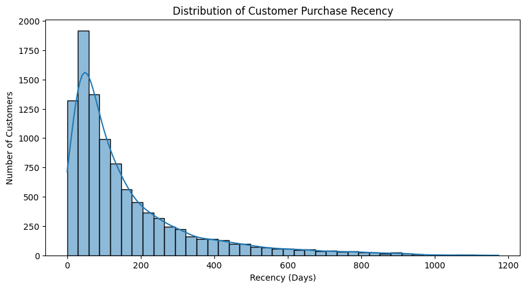

**Product Preference Analysis**

Business Question: Which product categories do customers purchase most frequently?

The distribution of completed transactions across product categories was examined to identify the most frequently purchased categories and understand customer product preferences.

Python Implementation:
```python
# Calculate category purchase frequency
category_purchases = (
    completed_df.groupby('product_category')['transaction_id']
    .nunique()
    .reset_index(name='purchase_count')
    .sort_values('purchase_count', ascending=False)
)

# Calculate purchase percentages
category_purchases['purchase_percentage'] = (
    category_purchases['purchase_count']
    / category_purchases['purchase_count'].sum()
) * 100
```

Results:
| Product Category | Purchase Count | Percentage |
|---|---:|---:|
| Fashion | 13,713 | 22.02% |
| Groceries | 12,393 | 19.90% |
| Electronics | 11,203 | 17.99% |
| Home & Living | 10,034 | 16.11% |
| Beauty | 8,521 | 13.68% |
| Sports | 6,030 | 9.68% |
| Unknown | 377 | 0.61% |

Interpretation: Fashion recorded the highest number of completed purchases, accounting for approximately 22.02% of all purchases, followed by Groceries and Electronics. Sports recorded the lowest known product category purchase count. These findings indicate differences in customer demand across product categories.

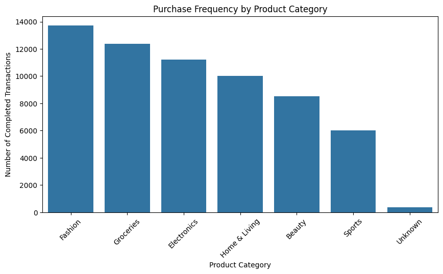

**Sales Channel Behaviour Analysis**

Business Question: Which sales channels do customers use most frequently to make purchases?

Completed transactions were grouped by sales channel to examine customer purchasing preferences across the available channels.

Python Implementation:
```python
# Examine sales channel distribution
channel_purchases = (
    completed_df['sales_channel']
    .value_counts()
    .reset_index()
)

channel_purchases.columns = [
    'sales_channel',
    'purchase_count'
]

# Calculate purchase percentages
channel_purchases['purchase_percentage'] = (
    channel_purchases['purchase_count']
    / channel_purchases['purchase_count'].sum()
) * 100
```

Results:
| Sales Channel | Purchase Count | Percentage |
|---|---:|---:|
| Mobile App | 21,158 | 33.98% |
| Website | 17,368 | 27.89% |
| In-store | 15,631 | 25.10% |
| Marketplace | 8,114 | 13.03% |

Interpretation: The Mobile App was the most frequently used sales channel, accounting for approximately 33.98% of completed purchases. The Website and In-store channels followed, while Marketplace recorded the lowest transaction share. This suggests that digital channels, particularly the Mobile App, play an important role in customer purchasing activities.

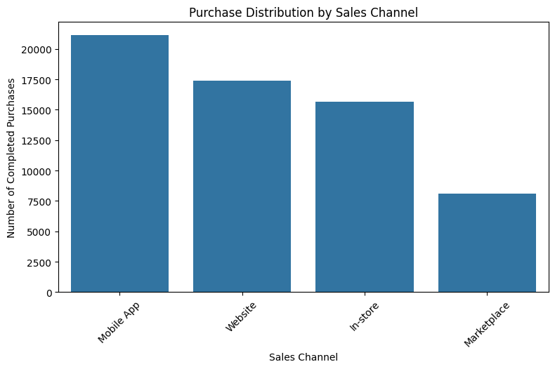

**Marketing Behaviour Analysis**

Business Question: How do customers respond to the company's marketing campaigns?

The distribution of campaign responses among completed transactions was examined to understand the level of customer engagement with the company's marketing activities.

Python Implementation:
```python
# Examine campaign response distribution
campaign_response = (
    completed_df['campaign_response']
    .value_counts()
    .reset_index()
)

campaign_response.columns = [
    'campaign_response',
    'response_count'
]

# Calculate response percentages
campaign_response['response_percentage'] = (
    campaign_response['response_count']
    / campaign_response['response_count'].sum()
) * 100
```

Results:
| Campaign Response | Transaction Count | Percentage |
|---|---:|---:|
| Not Exposed | 29,920 | 48.05% |
| Ignored | 21,811 | 35.03% |
| Responded | 10,540 | 16.93% |

Interpretation: Approximately 16.93% of completed transactions were associated with customers who responded to marketing campaigns, while 35.03% were associated with ignored campaigns. The remaining 48.05% were classified as not exposed. This highlights differences in recorded campaign engagement across transactions.


**Customer Demographics Analysis**

Business Question: What are the demographic characteristics of the company's customers?

The customer demographic dataset was constructed by retaining one record per unique customer. Age, annual income, membership tier, and geographical distribution were examined to understand the composition of the customer base.

Python Implementation:
```python
# Create customer-level demographic dataset
customer_demographics = (
    df.drop_duplicates(subset='customer_id').copy()
)

Age Distribution
The age distribution was examined using descriptive statistics, a histogram, and a boxplot\
# Descriptive statistics
customer_demographics['age'].describe()
```

Results:
| Statistic | Age |
|---|---:|
| Customers | 10,000 |
| Mean | 36.36 |
| Standard Deviation | 10.54 |
| Minimum | 11 |
| 25th Percentile | 29 |
| Median | 36 |
| 75th Percentile | 43 |
| Maximum | 78 |

Interpretation: The customer base had an average age of approximately 36 years, with a median of 36 years. Most customers were concentrated between the ages of 29 and 43, indicating a relatively young to middle-aged customer population.

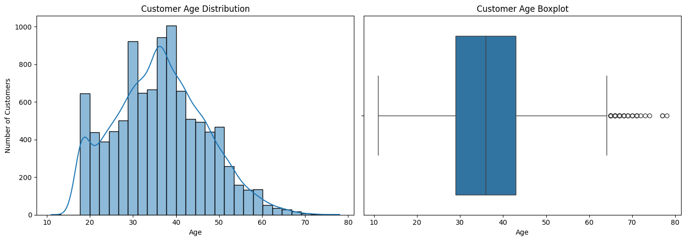

**Annual Income Distribution**

Annual income was examined to understand the income characteristics and variation across customers.

Python Implementation:
```python
# Descriptive statistics
customer_demographics['annual_income_ngn'].describe()
```

Results:
| Statistic | Annual Income (NGN) |
|---|---:|
| Customers | 10,000 |
| Mean | 3,947,983 |
| Standard Deviation | 34,564,000 |
| Minimum | 350,000 |
| 25th Percentile | 1,667,534 |
| Median | 2,378,022 |
| 75th Percentile | 3,393,782 |
| Maximum | 1,000,000,000 |

Interpretation: The median annual income was approximately ₦2.38 million, while the mean was approximately ₦3.95 million. The substantial difference between these values and the unusually high maximum indicate a highly skewed income distribution, suggesting the presence of extreme income observations requiring further investigation.

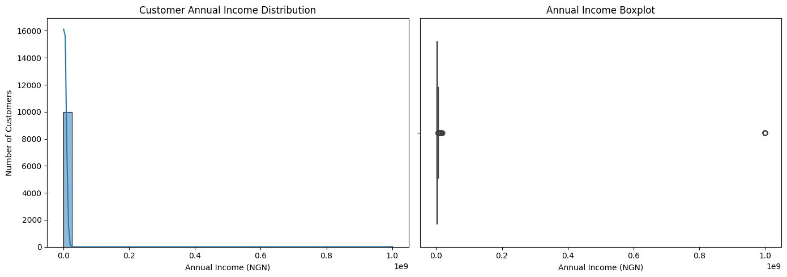

**Membership Tier Distribution**

Customer membership tiers were examined to understand how customers were distributed across the available membership categories.

Python Implementation:
```python
customer_demographics['membership_tier'].value_counts()
```

Results:
| Membership Tier | Customer Count |
|---|---:|
| Standard | 5,285 |
| Silver | 2,534 |
| Gold | 1,600 |
| Platinum | 556 |
| gold | 25 |

Interpretation: The Standard membership tier accounted for the largest proportion of customers, followed by Silver and Gold. Platinum had the lowest count. The separate gold category also revealed an inconsistency in categorical formatting that should be standardised before further categorical analysis.

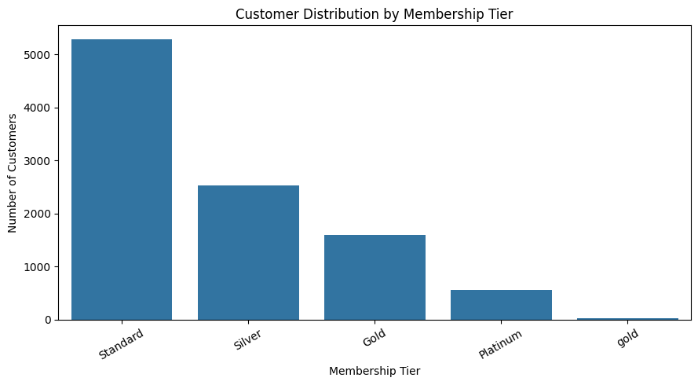

**Regional Distribution**

The geographical distribution of customers was examined using the region variable.

Python Implementation:
```python
customer_demographics['region'].value_counts()
```

Results:
| Region | Customer Count |
|---|---:|
| South | 2,791 |
| West | 2,386 |
| North | 1,778 |
| East | 1,551 |
| Central | 1,494 |

Interpretation: The South had the highest customer representation, followed by the West and North. The Central region recorded the lowest customer count. This provides an overview of the geographical distribution of the customer base.

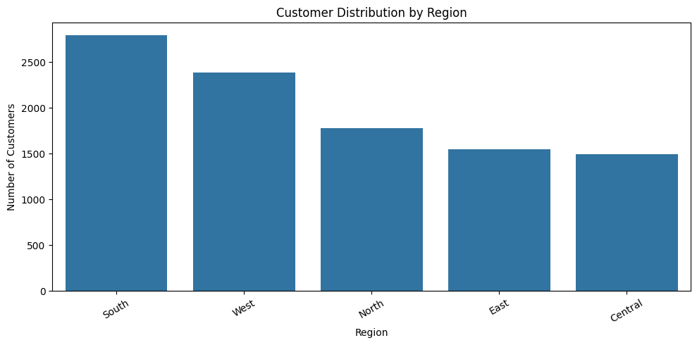

**Summary of Exploratory Data Analysis**

The exploratory analysis revealed several important patterns in customer demographics and purchasing behaviour:

1.	Purchasing Behaviour: Customers made an average of 6.28 completed purchases, with purchase frequency ranging from 1 to 25 transactions.
2.	Spending Behaviour: Average total customer spending was approximately ₦471,104.70, with considerable variation across customers.
3.	Average Order Value: The average order value was approximately ₦81,538.92.
4.	Purchase Recency: Customers had an average recency of approximately 161 days, indicating differences in how recently they made purchases.
5.	Product Preferences: Fashion was the most frequently purchased category, followed by Groceries and Electronics.
6.	Sales Channels: The Mobile App accounted for the highest transaction share at approximately 33.98%.
7.	Marketing Engagement: Only 16.93% of completed transactions were associated with a recorded campaign response.
8.	Customer Demographics: The average customer age was 36 years, while median annual income was approximately ₦2.38 million. The South had the highest customer representation.

**Overall Conclusion**

The analysis established that customers exhibit different purchasing frequencies, spending levels, product preferences, and engagement patterns. These differences provide useful behavioural indicators for developing customer-level features and identifying meaningful customer segments through machine learning.

The findings also highlighted data quality considerations, particularly the extreme annual income values and inconsistent membership tier labels, which require attention during subsequent feature preparation.

## CUSTOMER-LEVEL FEATURE ENGINEERING

This session documents the creation of customer-level variables from the cleaned transaction and customer datasets. The purpose was to transform individual transaction records into measurable customer characteristics that could be used for segmentation.

The features cover return behaviour, customer tenure, product and channel diversity, discount usage, marketing engagement, profitability, purchase frequency, spending consistency, recency, demographics, and historical customer value.

Important methodological distinction: completed_df was used for features based on successful purchases, while the original cleaned df was used for return-related features so that returned transactions were not excluded.

**Feature Engineering Overview
Feature engineering involved grouping records by customer_id, calculating customer-level metrics, and transforming selected numerical variables into behavioural or demographic categories.
The resulting feature tables were created separately and would subsequently be combined into a single customer-level dataset for modelling.

**Customer Return Behaviour**

Business question: What proportion of each customer's transactions are returned?

Return rate measures the proportion of a customer's total transactions that were returned. The original cleaned df was used because completed_df excludes returned transactions.

Python code:
```python
customer_returns = (
    df.groupby('customer_id')
    .agg(
        total_transactions=('transaction_id', 'nunique'),
        returned_transactions=(
            'order_status',
            lambda x: (x == 'Returned').sum()
        )
    )
    .reset_index()
)

customer_returns['return_rate'] = (
    customer_returns['returned_transactions']
    / customer_returns['total_transactions']
)

customer_returns['return_rate'].describe()
```

Results:
| Statistic | Return Rate |
|---|---:|
| Count | 10,000 |
| Mean | 0.0512 |
| Standard deviation | 0.1264 |
| Minimum | 0.0000 |
| 25th percentile | 0.0000 |
| Median | 0.0000 |
| 75th percentile | 0.0667 |
| Maximum | 1.0000 |

Interpretation: The average customer return rate was approximately 5.12%. At least half of the customers had a return rate of zero, while the maximum was 100%. This indicates that return behaviour varied across customers and could help distinguish customers with higher return tendencies.

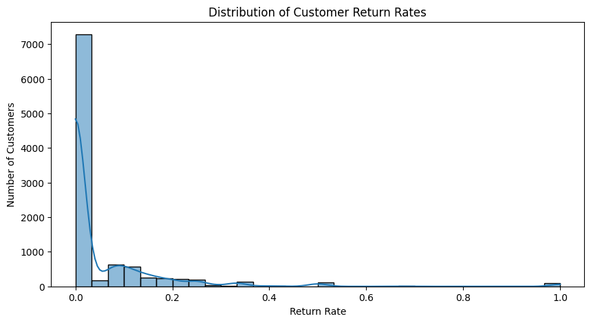

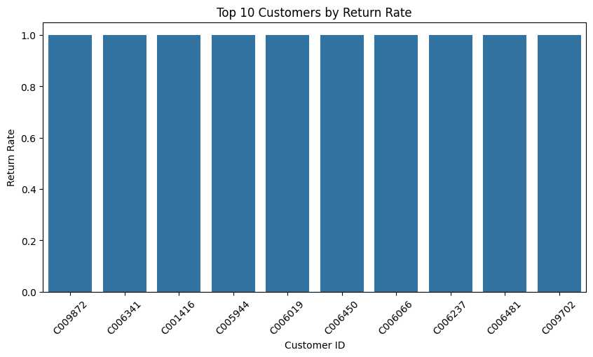

Python code for visualisations:
```python
# Return rate distribution
plt.figure(figsize=(10, 5))

sns.histplot(
    data=customer_returns,
    x='return_rate',
    bins=30,
    kde=True
)

plt.title('Distribution of Customer Return Rates')
plt.xlabel('Return Rate')
plt.ylabel('Number of Customers')
plt.show()


# Customers with the highest return rates
top_return_customers = (
    customer_returns
    .sort_values('return_rate', ascending=False)
    .head(10)
)

plt.figure(figsize=(10, 5))

sns.barplot(
    data=top_return_customers,
    x='customer_id',
    y='return_rate'
)

plt.title('Top 10 Customers by Return Rate')
plt.xlabel('Customer ID')
plt.ylabel('Return Rate')
plt.xticks(rotation=45)
plt.show()
```

**Customer Tenure**

Customer tenure measures how long a customer has maintained a relationship with the business, based on their signup date.

The latest transaction date in the completed transaction dataset was used as the reference date.

Python code:
```python
# Reference date
snapshot_date = completed_df['transaction_date'].max()

# Get one signup date per customer
customer_tenure = (
    df.groupby('customer_id')['signup_date']
    .min()
    .reset_index(name='signup_date')
)

# Calculate customer tenure
customer_tenure['tenure_days'] = (
    snapshot_date - customer_tenure['signup_date']
).dt.days

customer_tenure['tenure_days'].describe()
```

Results:
| Statistic | Tenure (days) |
|---|---:|
| Count | 10,000 |
| Mean | 711.23 |
| Standard deviation | 395.52 |
| Minimum | 29 |
| 25th percentile | 370 |
| Median | 714 |
| 75th percentile | 1,053 |
| Maximum | 1,398 |

Interpretation: Customers had an average tenure of approximately 711 days, or about 1.95 years. The wide range indicates differences in how long customers had maintained their relationship with the business.

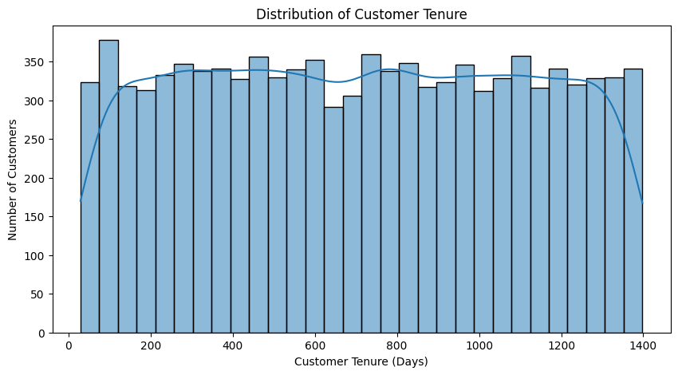

```python
plt.figure(figsize=(10, 5))

sns.histplot(
    data=customer_tenure,
    x='tenure_days',
    bins=30,
    kde=True
)

plt.title('Distribution of Customer Tenure')
plt.xlabel('Customer Tenure (Days)')
plt.ylabel('Number of Customers')
plt.show()
```

**Customer Purchase Diversity**

This feature measures the number of unique product categories purchased by each customer. Only completed transactions were considered.

Python code:
```python
customer_diversity = (
    completed_df.groupby('customer_id')['product_category']
    .nunique()
    .reset_index(name='category_diversity')
)

customer_diversity['category_diversity'].describe()

customer_diversity['category_diversity'].value_counts().sort_index()
```

Results:
| Statistic | Category Diversity |
|---|---:|
| Count | 9,912 |
| Mean | 3.42 |
| Standard deviation | 1.72 |
| Minimum | 1 |
| 25th percentile | 2 |
| Median | 4 |
| 75th percentile | 5 |
| Maximum | 7 |

| Unique Categories Purchased | Customers |
|---|---:|
| 1 | 2,005 |
| 2 | 1,419 |
| 3 | 1,502 |
| 4 | 1,689 |
| 5 | 2,010 |
| 6 | 1,220 |
| 7 | 67 |

Interpretation: Customers purchased from an average of approximately 3.42 product categories. Some customers concentrated their purchases in one category, while others purchased across several categories. This feature can help distinguish specialised buyers from customers with broader product interests.

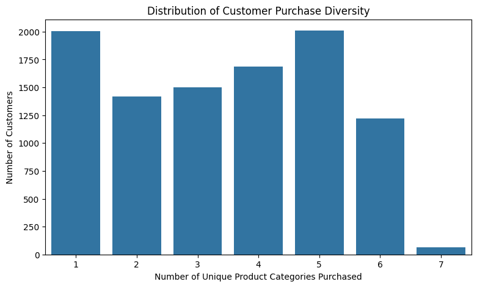

```python
plt.figure(figsize=(9, 5))

sns.countplot(
    data=customer_diversity,
    x='category_diversity'
)

plt.title('Distribution of Customer Purchase Diversity')
plt.xlabel('Number of Unique Product Categories Purchased')
plt.ylabel('Number of Customers')
plt.show()
```

**Customer Discount Behaviour**

This feature measures the average discount received by each customer across completed transactions. It helps identify customers who tend to purchase at full price and those who purchase with relatively higher discounts.

Python code:
```python
customer_discount = (
    completed_df.groupby('customer_id')['discount_pct']
    .mean()
    .reset_index(name='average_discount_pct')
)

customer_discount['average_discount_pct'].describe()
```

Results:
| Statistic | Average Discount |
|---|---:|
| Count | 9,912 |
| Mean | 0.1578 |
| Standard deviation | 0.0657 |
| Minimum | 0.0004 |
| 25th percentile | 0.1204 |
| Median | 0.1526 |
| 75th percentile | 0.1880 |
| Maximum | 0.5500 |

Interpretation: The average customer discount was approximately 15.78%, with a median of 15.26%. The variation suggests that customers differed in their exposure to or use of discounts.

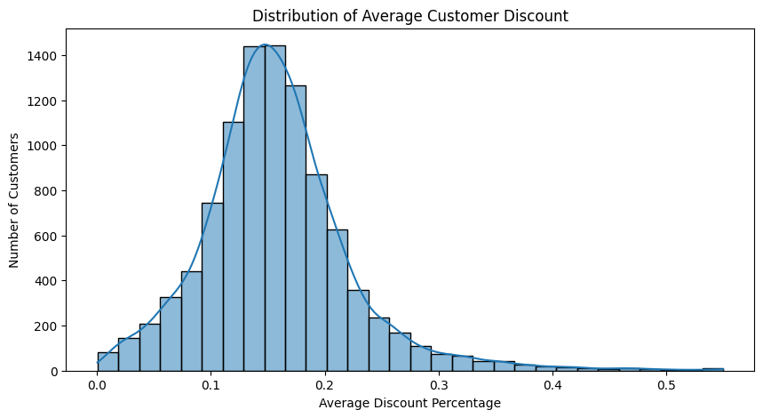

```python
plt.figure(figsize=(10, 5))

sns.histplot(
    data=customer_discount,
    x='average_discount_pct',
    bins=30,
    kde=True
)

plt.title('Distribution of Average Customer Discount')
plt.xlabel('Average Discount Percentage')
plt.ylabel('Number of Customers')
plt.show()
```

**Customer Marketing Engagement**

This feature measures how actively customers respond to marketing campaigns.

The response rate was calculated as:
```
Campaign Response Rate} = Successful Responses/Total Exposed Campaigns
```
An important distinction was maintained: Not Exposed was not treated as Ignored. Customers who were not exposed to a campaign could not be classified as unresponsive to it.

Initial campaign response distribution:
```python
completed_df['campaign_response'].value_counts(dropna=False)
```

| Campaign Response | Transactions |
|---|---:|
| Not Exposed | 29,920 |
| Ignored | 21,811 |
| Responded | 10,540 |

Python code for customer response rate:
```python
customer_marketing = (
    completed_df.groupby('customer_id')
    .agg(
        total_campaigns=(
            'campaign_response',
            lambda x: x.isin(['Responded', 'Ignored']).sum()
        ),
        successful_responses=(
            'campaign_response',
            lambda x: (x == 'Responded').sum()
        )
    )
    .reset_index()
)

customer_marketing['campaign_response_rate'] = (
    customer_marketing['successful_responses']
    / customer_marketing['total_campaigns'].replace(0, np.nan)
)

customer_marketing['campaign_response_rate'].describe()
```

Results:
| Statistic | Campaign Response Rate |
|---|---:|
| Count | 8,686 |
| Mean | 0.3229 |
| Standard deviation | 0.3141 |
| Minimum | 0.0000 |
| 25th percentile | 0.0000 |
| Median | 0.2857 |
| 75th percentile | 0.5000 |
| Maximum | 1.0000 |

Customers without campaign exposure:
```python
print(
    'Customers without campaign exposure:',
    customer_marketing['total_campaigns'].eq(0).sum()
)
```

Output:

Customers without campaign exposure: 1226

Interpretation: Among customers with campaign exposure, the average response rate was approximately 32.29%. A total of 1,226 customers had no exposed campaign records and therefore had undefined response rates. These customers should not be interpreted as having a zero response rate.

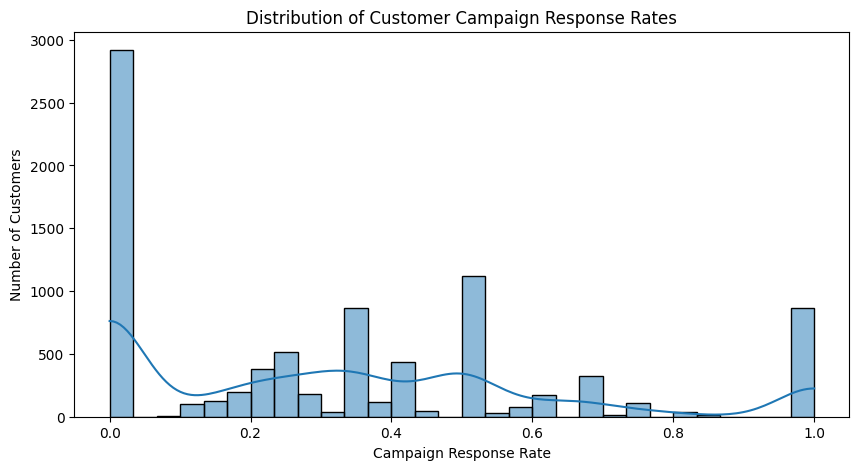

```python
plt.figure(figsize=(10, 5))

sns.histplot(
    data=customer_marketing,
    x='campaign_response_rate',
    bins=30,
    kde=True
)

plt.title('Distribution of Customer Campaign Response Rates')
plt.xlabel('Campaign Response Rate')
plt.ylabel('Number of Customers')
plt.show()
```

**Customer Profitability**

This feature measures the total profit generated by each customer from completed transactions

Customer profit was calculated as: 
```
Customer Profit} = Total Net Revenue - Total Cost
```

Python code:
```python
customer_profit = (
    completed_df.groupby('customer_id')
    .agg(
        total_revenue=('net_amount_ngn', 'sum'),
        total_cost=('cost_amount_ngn', 'sum')
    )
    .reset_index()
)

customer_profit['total_profit_ngn'] = (
    customer_profit['total_revenue'] -
    customer_profit['total_cost']
)

customer_profit['total_profit_ngn'].describe()
```

Results:
| Statistic | Total Profit (₦) |
|---|---:|
| Count | 9,912 |
| Mean | 120,102.90 |
| Standard deviation | 124,662.90 |
| Minimum | -273,461.70 |
| 25th percentile | 32,965.35 |
| Median | 86,267.17 |
| 75th percentile | 161,601.40 |
| Maximum | 1,140,839.00 |

Interpretation: The average customer generated approximately ₦120,102.90 in profit. However, the minimum value was negative, indicating that some customers' total costs exceeded their net revenue. Profitability therefore provides another useful dimension for distinguishing customer segments.

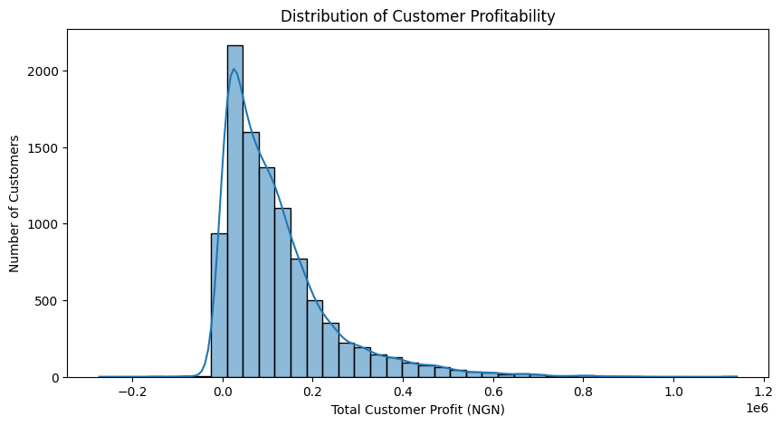

```python
plt.figure(figsize=(10, 5))

sns.histplot(
    data=customer_profit,
    x='total_profit_ngn',
    bins=40,
    kde=True
)

plt.title('Distribution of Customer Profitability')
plt.xlabel('Total Customer Profit (NGN)')
plt.ylabel('Number of Customers')
plt.show()
```

**Customer Purchase Channel Diversity**

This feature measures the number of distinct sales channels each customer uses to make purchases.

Python code:
```python
customer_channel = (
    completed_df.groupby('customer_id')['sales_channel']
    .nunique()
    .reset_index(name='channel_diversity')
)

customer_channel['channel_diversity'].describe()

customer_channel['channel_diversity'].value_counts().sort_index()
```

Results:
| Statistic | Channel Diversity |
|---|---:|
| Count | 9,912 |
| Mean | 2.69 |
| Standard deviation | 1.14 |
| Minimum | 1 |
| 25th percentile | 2 |
| Median | 3 |
| 75th percentile | 4 |
| Maximum | 4 |

| Number of Unique Channels | Customers |
|---|---:|
| 1 | 2,168 |
| 2 | 1,895 |
| 3 | 2,681 |
| 4 | 3,168 |

Interpretation: Customers used an average of approximately 2.69 different sales channels. A substantial number of customers used all four available channels, suggesting that many customers interacted with the business through multiple purchasing platforms.

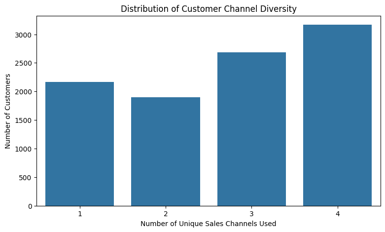

```python
plt.figure(figsize=(9, 5))

sns.countplot(
    data=customer_channel,
    x='channel_diversity'
)

plt.title('Distribution of Customer Channel Diversity')
plt.xlabel('Number of Unique Sales Channels Used')
plt.ylabel('Number of Customers')
plt.show()
```

**Monthly Customer Purchase Frequency**

This feature measures the average number of completed purchases a customer makes per active month.

Unlike total purchase frequency, it accounts for the period between a customer's first and last observed purchases. This helps distinguish customers who make purchases frequently within a shorter period from those whose purchases are spread over a longer period.

Python code:
```python
customer_monthly_frequency = (
    completed_df.groupby('customer_id')
    .agg(
        total_purchases=('transaction_id', 'nunique'),
        first_purchase=('transaction_date', 'min'),
        last_purchase=('transaction_date', 'max')
    )
    .reset_index()
)

customer_monthly_frequency['active_months'] = (
    (customer_monthly_frequency['last_purchase'].dt.year -
     customer_monthly_frequency['first_purchase'].dt.year) * 12
    +
    (customer_monthly_frequency['last_purchase'].dt.month -
     customer_monthly_frequency['first_purchase'].dt.month)
    + 1
)

customer_monthly_frequency['monthly_purchase_frequency'] = (
    customer_monthly_frequency['total_purchases'] /
    customer_monthly_frequency['active_months']
)

customer_monthly_frequency[
    'monthly_purchase_frequency'
].describe()
```

Results:
| Statistic | Monthly Purchase Frequency |
|---|---:|
| Count | 9,912 |
| Mean | 0.7069 |
| Standard deviation | 0.4593 |
| Minimum | 0.0690 |
| 25th percentile | 0.3571 |
| Median | 0.5833 |
| 75th percentile | 1.0000 |
| Maximum | 5.0000 |

Interpretation: Customers made an average of approximately 0.71 purchases per active month. The median was approximately 0.58 purchases per month, indicating differences in purchasing frequency across customers.

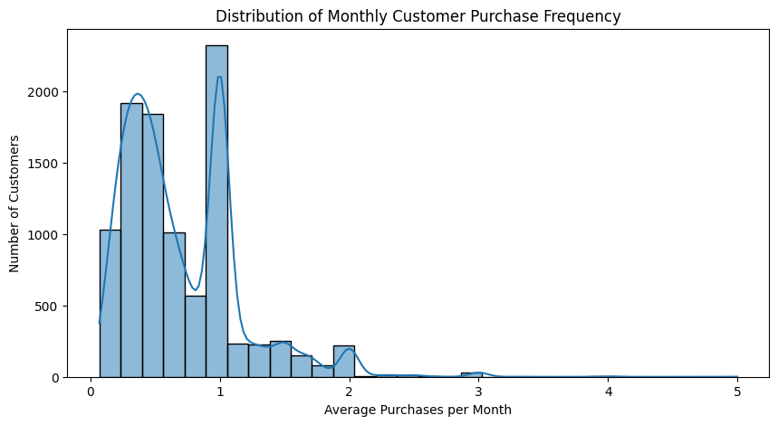

```python
plt.figure(figsize=(10, 5))

sns.histplot(
    data=customer_monthly_frequency,
    x='monthly_purchase_frequency',
    bins=30,
    kde=True
)

plt.title('Distribution of Monthly Customer Purchase Frequency')
plt.xlabel('Average Purchases per Month')
plt.ylabel('Number of Customers')
plt.show()
```

**Customer Spending Consistency**

This feature measures how consistent each customer's spending is across completed transactions. The standard deviation of transaction-level net amounts was used.

A lower standard deviation indicates relatively consistent transaction values, while a higher value indicates greater variation in spending.

Customers with only one completed transaction have no measurable spending variation, so their standard deviation is missing.

Python code:
```python
customer_spending_consistency = (
    completed_df.groupby('customer_id')['net_amount_ngn']
    .std()
    .reset_index(name='spending_std_ngn')
)

customer_spending_consistency['spending_std_ngn'].describe()
```

Results:
| Statistic | Spending Standard Deviation (₦) |
|---|---:|
| Count | 8,130 |
| Mean | 78,397.32 |
| Standard deviation | 87,600.57 |
| Minimum | 94.88 |
| 25th percentile | 28,630.68 |
| Median | 50,584.19 |
| 75th percentile | 92,926.50 |
| Maximum | 1,173,783.00 |

Interpretation: The standard deviation varied considerably across customers, indicating differences in transaction spending consistency. The count of 8,130 also shows that this feature was unavailable for customers without sufficient transaction observations to calculate a standard deviation.

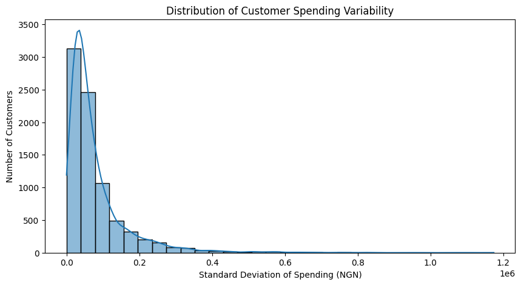

```python
plt.figure(figsize=(10, 5))

sns.histplot(
    data=customer_spending_consistency,
    x='spending_std_ngn',
    bins=30,
    kde=True
)

plt.title('Distribution of Customer Spending Variability')
plt.xlabel('Standard Deviation of Spending (NGN)')
plt.ylabel('Number of Customers')
plt.show()
```

**Average Profit per Transaction**

This feature measures the average profit generated per completed transaction for each customer.

It provides a transaction-level profitability measure rather than relying only on total customer profit.

Python code:
```python
customer_avg_profit = (
    completed_df.groupby('customer_id')
    .agg(
        total_profit_ngn=(
            'net_amount_ngn',
            lambda x: x.sum(min_count=1)
        ),
        total_cost_ngn=(
            'cost_amount_ngn',
            lambda x: x.sum(min_count=1)
        ),
        transaction_count=('transaction_id', 'nunique')
    )
    .reset_index()
)

customer_avg_profit['average_profit_per_transaction'] = (
    (customer_avg_profit['total_profit_ngn'] -
     customer_avg_profit['total_cost_ngn'])
    / customer_avg_profit['transaction_count']
)

customer_avg_profit[
    'average_profit_per_transaction'
].describe()
```

Results:
| Statistic | Average Profit per Transaction (₦) |
|---|---:|
| Count | 9,912 |
| Mean | 20,753.65 |
| Standard deviation | 22,434.90 |
| Minimum | -70,335.46 |
| 25th percentile | 9,315.84 |
| Median | 13,823.18 |
| 75th percentile | 25,680.09 |
| Maximum | 706,389.79 |

Interpretation: The average profit per completed transaction was approximately ₦20,753.65. Negative values indicate customers whose average transaction cost exceeded their net revenue. The difference between the mean and median also indicates variation in transaction-level profitability.

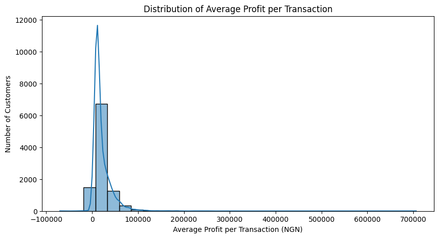

```python
plt.figure(figsize=(10, 5))

sns.histplot(
    data=customer_avg_profit,
    x='average_profit_per_transaction',
    bins=30,
    kde=True
)

plt.title('Distribution of Average Profit per Transaction')
plt.xlabel('Average Profit per Transaction (NGN)')
plt.ylabel('Number of Customers')
plt.show()
```

**Customer Return Frequency**

While return rate measures the proportion of transactions returned, return frequency measures the actual number of returned transactions for each customer.

The original cleaned df was used because returned transactions are excluded from completed_df.

Python code:
```python
customer_return_frequency = (
    df.groupby('customer_id')
    .agg(
        total_returned_transactions=(
            'order_status',
            lambda x: (x == 'Returned').sum()
        )
    )
    .reset_index()
)

customer_return_frequency[
    'total_returned_transactions'
].describe()

customer_return_frequency[
    'total_returned_transactions'
].value_counts().sort_index()
```

Results:
| Statistic | Returned Transactions |
|---|---:|
| Count | 10,000 |
| Mean | 0.3368 |
| Standard deviation | 0.6140 |
| Minimum | 0 |
| 25th percentile | 0 |
| Median | 0 |
| 75th percentile | 1 |
| Maximum | 5 |

| Returned Transactions | Customers |
|---|---:|
| 0 | 7,284 |
| 1 | 2,164 |
| 2 | 467 |
| 3 | 71 |
| 4 | 13 |
| 5 | 1 |

Interpretation: Customers had an average of approximately 0.34 returned transactions. Most customers (7,284) had no returned transactions, while only a small number recorded multiple returns.

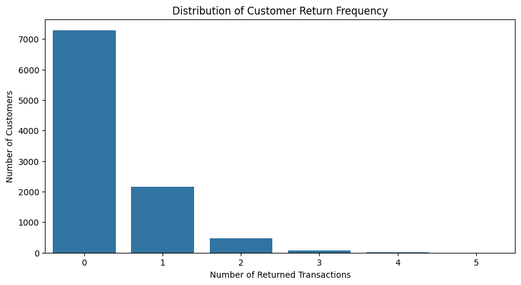\

```python
plt.figure(figsize=(10, 5))

sns.countplot(
    data=customer_return_frequency,
    x='total_returned_transactions'
)

plt.title('Distribution of Customer Return Frequency')
plt.xlabel('Number of Returned Transactions')
plt.ylabel('Number of Customers')
plt.show()
```

**Customer Profit Margin**

This feature measures the percentage of a customer's net revenue retained as profit.

It was calculated using the previously created customer profitability table.
```
Profit Margin} = Total Profit/Total Revenue
```

Python code:
```python
customer_profit['profit_margin'] = (
    customer_profit['total_profit_ngn']
    / customer_profit['total_revenue']
)

customer_profit['profit_margin'].describe()
```

Results:
| Statistic | Profit Margin |
|---|---:|
| Count | 9,912 |
| Mean | 0.2715 |
| Standard deviation | 0.0934 |
| Minimum | -1.6401 |
| 25th percentile | 0.2123 |
| Median | 0.2720 |
| 75th percentile | 0.3249 |
| Maximum | 0.7658 |

Interpretation: The average customer profit margin was approximately 27.15%. The negative minimum indicates that some customers generated losses relative to their net revenue. This feature provides an additional measure of customer-level financial contribution.

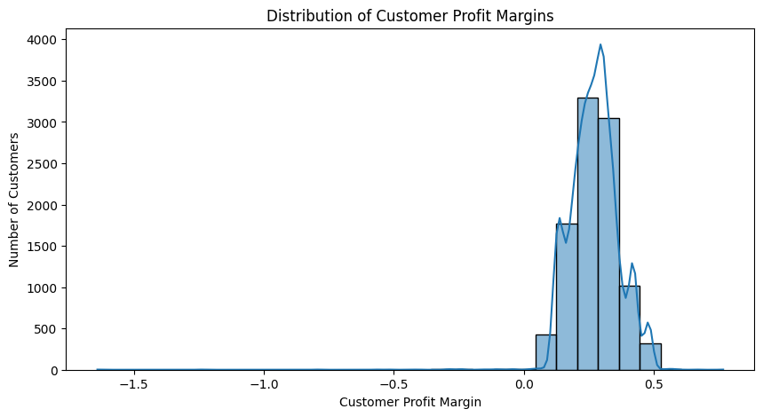

```python
plt.figure(figsize=(10, 5))

sns.histplot(
    data=customer_profit,
    x='profit_margin',
    bins=30,
    kde=True
)

plt.title('Distribution of Customer Profit Margins')
plt.xlabel('Customer Profit Margin')
plt.ylabel('Number of Customers')
plt.show()
```

**Customer Purchase Recency Category**

Customer recency measures the number of days since a customer's last completed purchase. This feature was transformed from a continuous numerical variable into five behavioural categories using binning.

The categories were defined as follows:
| Recency Range | Category |
|---|---|
| 0–30 days | Very Recent |
| 31–90 days | Recent |
| 91–180 days | Moderate |
| 181–365 days | At Risk |
| More than 365 days | Inactive |

Python code:
```python
snapshot_date = completed_df['transaction_date'].max()

customer_recency = (
    completed_df.groupby('customer_id')['transaction_date']
    .max()
    .reset_index(name='last_purchase_date')
)

customer_recency['recency_days'] = (
    snapshot_date - customer_recency['last_purchase_date']
).dt.days

customer_recency['recency_category'] = pd.cut(
    customer_recency['recency_days'],
    bins=[-1, 30, 90, 180, 365, float('inf')],
    labels=[
        'Very Recent',
        'Recent',
        'Moderate',
        'At Risk',
        'Inactive'
    ]
)

customer_recency['recency_category'].value_counts().sort_index()
```

Results:
| Recency Category | Customers |
|---|---:|
| Very Recent | 1,395 |
| Recent | 3,324 |
| Moderate | 2,294 |
| At Risk | 1,766 |
| Inactive | 1,133 |
| Total | 9,912 |

Interpretation: The largest group consisted of customers classified as Recent, with 3,324 customers. A further 1,766 customers were classified as At Risk, while 1,133 were Inactive. These categories provide a practical way to identify customers who may require retention or re-engagement campaigns.

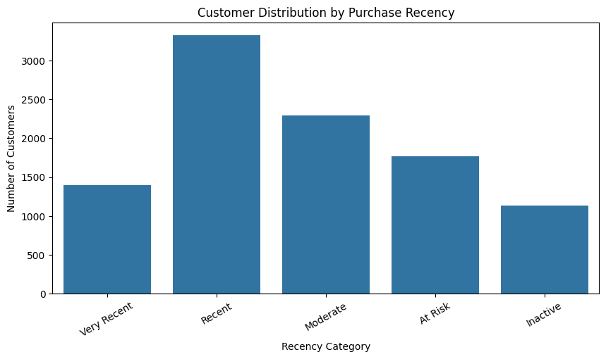

```python
plt.figure(figsize=(10, 5))

sns.countplot(
    data=customer_recency,
    x='recency_category',
    order=[
        'Very Recent',
        'Recent',
        'Moderate',
        'At Risk',
        'Inactive'
    ]
)

plt.title('Customer Distribution by Purchase Recency')
plt.xlabel('Recency Category')
plt.ylabel('Number of Customers')
plt.xticks(rotation=30)
plt.show()
```

**Customer Age Group**

Customer age was transformed into demographic categories to make age-related customer patterns easier to interpret.

Python code:
```python
customer_demographics['age_group'] = pd.cut(
    customer_demographics['age'],
    bins=[-float('inf'), 24, 34, 44, 54, float('inf')],
    labels=[
        'Young',
        'Young Adult',
        'Adult',
        'Middle-aged',
        'Senior'
    ]
)

customer_demographics['age_group'].value_counts().sort_index()

customer_demographics['age_group'].value_counts(
    normalize=True
).mul(100).round(2)
```

Results:
| Age Group | Customers | Percentage |
|---|---:|---:|
| Young | 1,472 | 14.72% |
| Young Adult | 2,830 | 28.30% |
| Adult | 3,468 | 34.68% |
| Middle-aged | 1,747 | 17.47% |
| Senior | 483 | 4.83% |
| Total | 10,000 | 100% |

Interpretation: Adults aged 35–44 formed the largest demographic group, representing 34.68% of customers. Young Adults accounted for another 28.30%, while Seniors represented the smallest group at 4.83%. The age-group feature provides a categorical demographic variable for customer profiling.

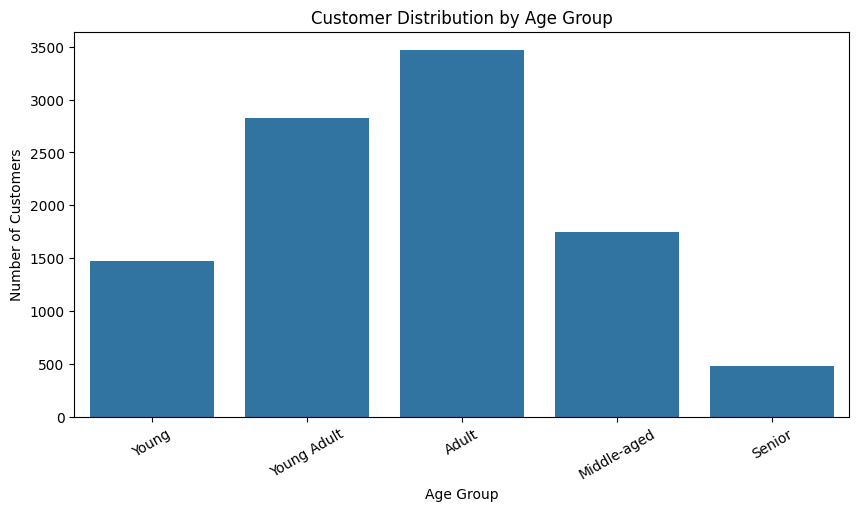

```python
plt.figure(figsize=(10, 5))

sns.countplot(
    data=customer_demographics,
    x='age_group',
    order=[
        'Young',
        'Young Adult',
        'Adult',
        'Middle-aged',
        'Senior'
    ]
)

plt.title('Customer Distribution by Age Group')
plt.xlabel('Age Group')
plt.ylabel('Number of Customers')
plt.xticks(rotation=30)
plt.show()
```

**Customer Lifetime Value (CLV) Proxy**

This feature estimates the total revenue generated by each customer over their observed purchasing history. Since it uses historical transaction revenue rather than a predictive lifetime value model, it is treated as a historical customer value or CLV proxy.

Only completed transactions were included.

Python code:
```python
customer_lifetime_value = (
    completed_df.groupby('customer_id')['net_amount_ngn']
    .sum(min_count=1)
    .reset_index(name='historical_customer_value_ngn')
)

customer_lifetime_value[
    'historical_customer_value_ngn'
].describe()
```

Results:
| Statistic | Historical Customer Value (₦) |
|---|---:|
| Count | 9,912 |
| Mean | 471,104.70 |
| Standard deviation | 500,038.30 |
| Minimum | 1,945.04 |
| 25th percentile | 119,622.30 |
| Median | 329,314.10 |
| 75th percentile | 630,604.30 |
| Maximum | 4,824,470.00 |

Interpretation: Customers generated an average historical net revenue of approximately ₦471,104.70. The substantial difference between the mean and median indicates variation in customer value, with some customers contributing considerably more revenue than others.

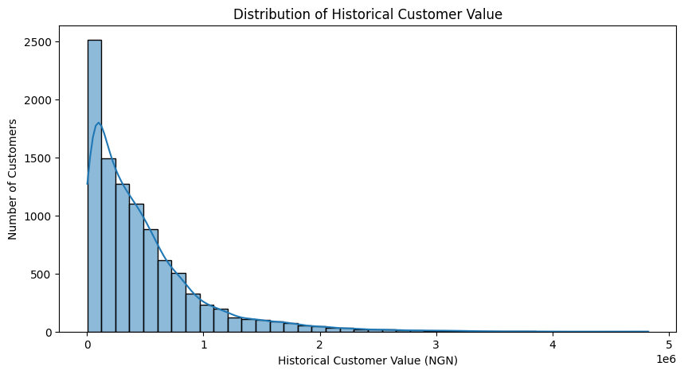

```python
plt.figure(figsize=(10, 5))

sns.histplot(
    data=customer_lifetime_value,
    x='historical_customer_value_ngn',
    bins=40,
    kde=True
)

plt.title('Distribution of Historical Customer Value')
plt.xlabel('Historical Customer Value (NGN)')
plt.ylabel('Number of Customers')
plt.show()
```

**Customer Acquisition Year**

Customer acquisition year was extracted from each customer's signup date. This feature identifies when customers joined the business and can help reveal differences in customer acquisition across years.

The customer_demographics dataset was used because it contains one record per customer.

Python code:
```python
# Extract acquisition year
customer_demographics['acquisition_year'] = (
    customer_demographics['signup_date'].dt.year
)

customer_demographics['acquisition_year'].value_counts().sort_index()
```

Results:
| Acquisition Year | Customers |
|---|---:|
| 2022 | 2,208 |
| 2023 | 2,687 |
| 2024 | 2,653 |
| 2025 | 2,452 |
| Total | 10,000 |

Interpretation: The highest number of customers joined in 2023, with 2,687 signups, followed closely by 2024 with 2,653. The acquisition-year feature provides a temporal dimension for examining customer groups based on when they joined the business.

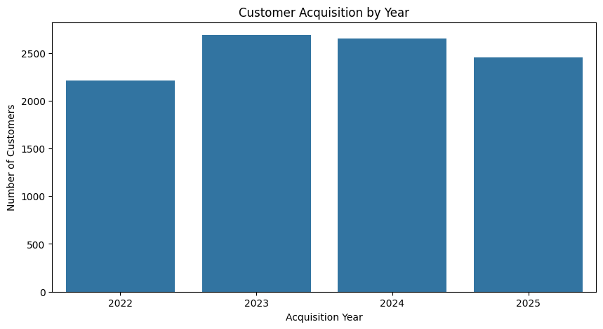

```python
plt.figure(figsize=(10, 5))

sns.countplot(
    data=customer_demographics,
    x='acquisition_year',
    order=sorted(
        customer_demographics['acquisition_year'].dropna().unique()
    )
)

plt.title('Customer Acquisition by Year')
plt.xlabel('Acquisition Year')
plt.ylabel('Number of Customers')
plt.show()
```

**Feature Engineering Summary**

The feature engineering process produced a collection of customer-level variables covering purchasing behaviour, financial contribution, demographics, marketing engagement, and customer relationships.

| Feature Group | Engineered Features |
|---|---|
| Purchasing behaviour | Purchase frequency, monthly purchase frequency, recency, recency category |
| Spending behaviour | Total spending, average order value, spending consistency |
| Product and channel preferences | Category diversity, channel diversity |
| Returns | Return rate, return frequency |
| Marketing | Campaign response rate |
| Financial performance | Total profit, average profit per transaction, profit margin |
| Customer relationship | Tenure, acquisition year |
| Customer demographics | Age group |
| Customer value | Historical customer value (CLV proxy) |
| Other behavioural variables | Average discount received |

Important observations before modelling
- Most customer-level features based on completed transactions contain 9,912 customers rather than 10,000. This is because 88 customers had no completed transactions.
- Campaign response rate was available for 8,686 customers. The remaining 1,226 customers had no exposed campaign records, so their response rates were undefined.
- Spending consistency was available for 8,130 customers because customers with only one completed transaction could not have a transaction-level spending standard deviation calculated.
- Return rate and return frequency were calculated using the original cleaned dataset to include returned transactions.
- Historical customer value is based on observed net revenue. It is a CLV proxy, not a prediction of future customer lifetime value.

## CONSTRUCTION OF THE FINAL CUSTOMER-LEVEL DATASET

This stage consolidated the engineered feature tables into a single customer-level dataset.

The original dataset contained multiple transaction records per customer. However, customer segmentation requires one consolidated record per customer, with each row representing an individual customer and each column representing a demographic, behavioural, or financial feature.

The objective was therefore to combine the previously engineered feature tables while preserving one record per customer.

**Inspection of Existing Feature Tables**

Before merging, the dimensions of all available feature tables were inspected to understand their structures and identify which tables contained all 10,000 customers and which contained only customers with completed transactions.

Python code:
```python
feature_tables = {
    'customer_demographics': customer_demographics,
    'purchase_frequency': purchase_frequency,
    'customer_spending': customer_spending,
    'customer_aov': customer_aov,
    'customer_recency': customer_recency,
    'customer_returns': customer_returns,
    'customer_tenure': customer_tenure,
    'customer_diversity': customer_diversity,
    'customer_discount': customer_discount,
    'customer_marketing': customer_marketing,
    'customer_profit': customer_profit,
    'customer_channel': customer_channel,
    'customer_monthly_frequency': customer_monthly_frequency,
    'customer_spending_consistency': customer_spending_consistency,
    'customer_avg_profit': customer_avg_profit,
    'customer_return_frequency': customer_return_frequency,
    'customer_lifetime_value': customer_lifetime_value
}

for name, table in feature_tables.items():
    print(f'{name}: {table.shape}')
```

Results:
| Feature Table | Shape |
|---|---|
| customer_demographics | (10,000, 31) |
| purchase_frequency | (9,912, 2) |
| customer_spending | (9,912, 2) |
| customer_aov | (9,912, 2) |
| customer_recency | (9,912, 4) |
| customer_returns | (10,000, 4) |
| customer_tenure | (10,000, 3) |
| customer_diversity | (9,912, 2) |
| customer_discount | (9,912, 2) |
| customer_marketing | (9,912, 4) |
| customer_profit | (9,912, 5) |
| customer_channel | (9,912, 2) |
| customer_monthly_frequency | (9,912, 6) |
| customer_spending_consistency | (9,912, 2) |
| customer_avg_profit | (9,912, 5) |
| customer_return_frequency | (10,000, 2) |
| customer_lifetime_value | (9,912, 2) |

Interpretation: The demographic, tenure, return-rate, and return-frequency tables contained 10,000 customers. Most purchase-related feature tables contained 9,912 customers because 88 customers had no completed transactions.

This difference was important when deciding how to construct the final dataset.

**Merging the Feature Tables**

The demographic dataset was selected as the starting point because it contained one record for every customer.

The remaining feature tables were merged using customer_id as the common identifier. A left join was applied to retain all customers from the demographic dataset.

The validate='one_to_one' argument was included to ensure that each merge maintained a one-to-one relationship between customer records.

Python code:
```python
# Start with the demographic dataset
customer_features = customer_demographics.copy()

# Select only the useful columns from overlapping feature tables
feature_tables_to_merge = [
    purchase_frequency,
    customer_spending,
    customer_aov,
    customer_recency,
    customer_returns,
    customer_tenure[['customer_id', 'tenure_days']],
    customer_diversity,
    customer_discount,
    customer_marketing,
    customer_profit,
    customer_channel,
    customer_monthly_frequency[
        ['customer_id', 'monthly_purchase_frequency']
    ],
    customer_spending_consistency,
    customer_avg_profit[
        ['customer_id', 'average_profit_per_transaction']
    ]
]

# Merge all selected features into one customer-level dataset
for table in feature_tables_to_merge:
    customer_features = customer_features.merge(
        table,
        on='customer_id',
        how='left',
        validate='one_to_one'
    )

print("Final dataset shape:", customer_features.shape)
print("Unique customers:", customer_features['customer_id'].nunique())
print("Duplicate customer IDs:", customer_features['customer_id'].duplicated().sum())
```

Results:

Final dataset shape: (10000, 54)

Unique customers: 10000

Duplicate customer IDs: 0

Interpretation: The merged dataset contained 10,000 customer records and 54 columns. Each customer appeared exactly once, confirming that the merging process preserved the required customer-level structure.

**Missing Value Assessment**

After merging, missing values were examined to identify features that were incomplete and determine whether the missing values represented genuine absence of customer activity or data quality problems.

Python code:
```python
# Calculate missing values
missing_summary = pd.DataFrame({
    'missing_count': customer_features.isnull().sum(),
    'missing_percentage': (
        customer_features.isnull().mean() * 100
    )
})

# Keep only columns with missing values
missing_summary = (
    missing_summary[missing_summary['missing_count'] > 0]
    .sort_values('missing_percentage', ascending=False)
)

missing_summary
```

Results:
| Feature | Missing Count | Missing Percentage |
|---|---:|---:|
| spending_std_ngn | 1,870 | 18.70% |
| campaign_response_rate | 1,314 | 13.14% |
| purchase_frequency | 88 | 0.88% |
| average_order_value_ngn | 88 | 0.88% |
| total_spending_ngn | 88 | 0.88% |
| recency_category | 88 | 0.88% |
| last_purchase_date | 88 | 0.88% |
| category_diversity | 88 | 0.88% |
| average_discount_pct | 88 | 0.88% |
| total_campaigns | 88 | 0.88% |
| recency_days | 88 | 0.88% |
| successful_responses | 88 | 0.88% |
| total_revenue | 88 | 0.88% |
| total_profit_ngn | 88 | 0.88% |
| total_cost | 88 | 0.88% |
| profit_margin | 88 | 0.88% |
| channel_diversity | 88 | 0.88% |
| monthly_purchase_frequency | 88 | 0.88% |
| average_profit_per_transaction | 88 | 0.88% |

Interpretation: Three important missing-value patterns emerged:

1.	Customers without completed purchases: 88 customers had missing values across several purchase-related features because they had no completed transactions.
2.	Spending consistency: 1,870 customers had missing spending standard deviations. This included customers with only one completed transaction, for whom spending variability could not be calculated.
3.	Campaign response rate: 1,314 customers had undefined campaign response rates. This included customers without completed purchases and customers who had no campaign exposure.
4.	These missing values required different treatments because they did not all have the same underlying cause.
5.	5.19.4 Investigating the Missing Values
6.	
Additional checks were performed to understand the missing-value patterns.

Python code:
```python
# Check customers without completed purchases
print(
    "Customers without purchase frequency:",
    customer_features['purchase_frequency'].isna().sum()
)

# Check customers with only one completed purchase
print(
    "Customers with one purchase:",
    (customer_features['purchase_frequency'] == 1).sum()
)

# Check missing spending consistency
print(
    "Missing spending standard deviation:",
    customer_features['spending_std_ngn'].isna().sum()
)

# Check customers without campaign exposure
print(
    "Customers without campaign exposure:",
    customer_features['total_campaigns'].isna().sum()
)

print(
    "Customers with zero campaign exposure:",
    (customer_features['total_campaigns'] == 0).sum()
)
```

Results:

Customers without purchase frequency: 88

Customers with one purchase: 1782

Missing spending standard deviation: 1870

Customers without campaign exposure: 88

Customers with zero campaign exposure: 1226

Interpretation:
- 88 customers had no completed purchases.
- 1,782 customers had exactly one completed purchase.
- 1,870 customers had missing spending standard deviation, corresponding to customers for whom transaction-level spending variability could not be calculated.
- 1,226 customers had zero campaign exposure.
- The 88 customers without completed purchases also had missing campaign information in the merged dataset.
  
The distinction between missing campaign information and zero campaign exposure was important. A customer with no campaign exposure should not automatically be classified as having a zero campaign response rate.

**Creating the Clustering Dataset**

Two datasets were retained to serve different purposes:
- customer_features: the complete dataset containing all 10,000 customers, retained for business analysis.
- clustering_df: a filtered dataset containing customers with at least one completed purchase, selected for the initial behavioural segmentation.
- 
This decision ensured that customers without completed purchases did not introduce missing values across several purchase-related variables during the initial clustering process.

Python code:
```python
# Keep customers with at least one completed purchase
clustering_df = customer_features[
    customer_features['purchase_frequency'].notna()
].copy()

print("Clustering dataset shape:", clustering_df.shape)
print("Unique customers:", clustering_df['customer_id'].nunique())

print(
    "Missing purchase frequency:",
    clustering_df['purchase_frequency'].isna().sum()
)
```

Results:

Clustering dataset shape: (9912, 54)

Unique customers: 9912

Missing purchase frequency: 0

Interpretation: The clustering dataset contained 9,912 customers and 54 columns. All selected customers had at least one completed purchase, and purchase frequency contained no missing values.

The original 10,000-customer dataset was retained separately so that the 88 customers excluded from the initial clustering population were not lost from the overall business analysis.

**Investigating Campaign Exposure**

Before finalising the campaign features, the distribution of campaign exposure was examined.

This was necessary because customers with no campaign exposure should be distinguished from customers who were exposed but did not respond.

Python code:
```python
print(
    clustering_df['total_campaigns']
    .value_counts(dropna=False)
    .sort_index()
)
```

Results:
| Exposed Campaign Records | Customers |
|---:|---:|
| 0 | 1,226 |
| 1 | 2,122 |
| 2 | 1,445 |
| 3 | 1,188 |
| 4 | 1,016 |
| 5 | 880 |
| 6 | 691 |
| 7 | 523 |
| 8 | 370 |
| 9 | 215 |
| 10 | 116 |
| 11 | 48 |
| 12 | 37 |
| 13 | 22 |
| 14 | 6 |
| 15 | 5 |
| 16 | 2 |
| **Total** | **9,912** |

Interpretation: A total of 1,226 customers had no exposed campaign records, while the remaining 8,686 customers had at least one exposed campaign record.

This confirmed the need to retain campaign exposure as a separate feature rather than relying exclusively on campaign response rate.

**Creating the Campaign Exposure Feature**

A binary feature named campaign_exposed was created to identify whether each customer had experienced at least one marketing campaign.

The feature was encoded as:
- 1: Customer had at least one exposed campaign record.
- 0: Customer had no exposed campaign records.

Python code:
```python
# Identify customers who have experienced at least one campaign
clustering_df['campaign_exposed'] = (
    clustering_df['total_campaigns'] > 0
).astype(int)
```

Interpretation: This feature allows the segmentation model to distinguish customers who were exposed to marketing campaigns from those who were not. It also preserves the distinction between lack of exposure and lack of response.

**Customer-Level Dataset Construction Summary**

The dataset construction stage successfully consolidated the engineered feature tables into a single customer-level structure.
| Description | Result |
|---|---:|
| Original customer records | 10,000 |
| Final customer-level records | 10,000 |
| Final columns before campaign exposure feature | 54 |
| Duplicate customer IDs | 0 |
| Customers with completed purchases | 9,912 |
| Customers without completed purchases | 88 |
| Customers with campaign exposure | 8,686 |
| Customers without campaign exposure | 1,226 |

Two datasets were retained:
| Dataset | Records | Purpose |
|---|---:|---|
| customer_features | 10,000 | Complete customer-level business analysis |
| clustering_df | 9,912 | Initial behavioural segmentation |

**Conclusion**

The feature tables were successfully consolidated into a single customer-level dataset, ensuring that each customer was represented by one row. Missing values were investigated according to their underlying causes, and a separate clustering dataset was created containing customers with at least one completed purchase.

The campaign exposure feature was also introduced to preserve important marketing information.

## FEATURE SELECTION AND PREPROCESSING

**Feature Selection Overview**

The customer-level dataset contained 54 columns, but not all were suitable for K-Means clustering. Some columns were identifiers, transaction-level details, descriptive categories, or features containing overlapping information.

The objective of feature selection was to identify numerical variables that meaningfully represent customer behaviour while reducing redundancy. This is important because K-Means uses distance calculations, and highly correlated features can give certain behavioural patterns disproportionate influence.

**Reviewing the Available Features**

The columns in clustering_df were inspected to distinguish potential clustering variables from profiling and descriptive columns.

Python code:
```python
for col in clustering_df.columns:
    print(col)
```

The inspection identified 54 columns, including customer demographics, transaction details, purchasing behaviour, marketing engagement, profitability, and engineered customer-level features.

Examples of columns not selected as direct clustering inputs included:
- customer_id and transaction_id: identifiers.
- transaction_date, signup_date, and last_purchase_date: date fields.
- product_category, payment_method, sales_channel, and region: categorical or descriptive variables.
- gross_amount_ngn, net_amount_ngn, and cost_amount_ngn: transaction-level financial variables.
- price_upper_bound, price_lower_bound, and outlier flags: data-cleaning information.

The selection process therefore focused on customer-level numerical features.

**Creating the Initial Candidate Feature Dataset**

Twenty numerical features were initially selected for further evaluation.

Python code:
```python
candidate_features = [
    'age',
    'annual_income_ngn',
    'purchase_frequency',
    'total_spending_ngn',
    'average_order_value_ngn',
    'recency_days',
    'total_transactions',
    'returned_transactions',
    'return_rate',
    'tenure_days',
    'category_diversity',
    'average_discount_pct',
    'total_campaigns',
    'successful_responses',
    'campaign_response_rate',
    'total_profit_ngn',
    'profit_margin',
    'channel_diversity',
    'monthly_purchase_frequency',
    'average_profit_per_transaction'
]

X = clustering_df[candidate_features].copy()

print("Candidate feature dataset:", X.shape)
print("Number of candidate features:", len(candidate_features))
print("Missing values:", X.isnull().sum().sum())
```

Results:
| Metric | Result |
|---|---:|
| Customers | 9,912 |
| Candidate features | 20 |
| Dataset shape | (9,912, 20) |
| Missing values | 1,226 |

The 1,226 missing values were associated with campaign_response_rate, representing customers without recorded campaign exposure.

**Correlation and Redundancy Analysis**

Pearson correlation was used to examine the relationships between candidate features. This helped identify variables that might represent similar customer behaviours.

Python code:
```python
correlation_matrix = X.corr(method='pearson')

correlation_matrix
```

The correlation matrix was visualised using a heatmap.

```python
import matplotlib.pyplot as plt
import seaborn as sns

plt.figure(figsize=(18, 14))

sns.heatmap(
    correlation_matrix,
    annot=True,
    fmt='.2f',
    cmap='coolwarm',
    center=0,
    linewidths=0.5
)

plt.title('Correlation Matrix of Candidate Clustering Features')
plt.xticks(rotation=90)
plt.yticks(rotation=0)
plt.tight_layout()
plt.show()
```
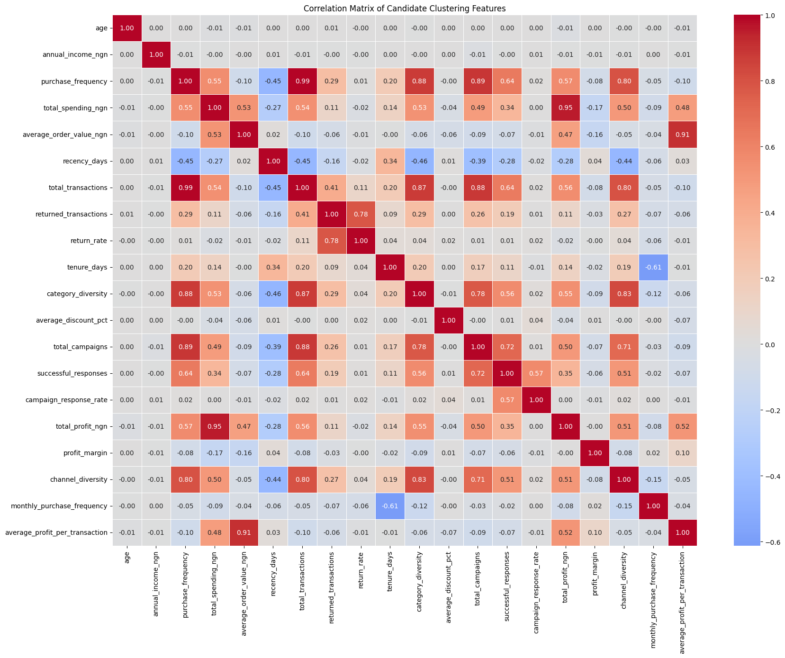

To identify strongly correlated pairs systematically, correlations with an absolute value of at least 0.80 were extracted.

Python code:
```python
upper_triangle = correlation_matrix.where(
    np.triu(np.ones(correlation_matrix.shape), k=1).astype(bool)
)

high_correlations = (
    upper_triangle.stack()
    .reset_index()
)

high_correlations.columns = [
    'feature_1',
    'feature_2',
    'correlation'
]

high_correlations = (
    high_correlations[
        high_correlations['correlation'].abs() >= 0.80
    ]
    .sort_values(
        'correlation',
        key=abs,
        ascending=False
    )
)

high_correlations
```

Highly correlated feature pairs identified:
| Feature 1 | Feature 2 | Correlation |
|---|---|---:|
| purchase_frequency | total_transactions | 0.993 |
| total_spending_ngn | total_profit_ngn | 0.952 |
| average_order_value_ngn | average_profit_per_transaction | 0.906 |
| purchase_frequency | total_campaigns | 0.888 |
| total_transactions | total_campaigns | 0.881 |
| purchase_frequency | category_diversity | 0.876 |
| total_transactions | category_diversity | 0.874 |
| category_diversity | channel_diversity | 0.830 |
| purchase_frequency | channel_diversity | 0.803 |
| total_transactions | channel_diversity | 0.802 |

The results revealed several overlapping relationships. For example, purchase_frequency and total_transactions had an almost perfect correlation, while total_spending_ngn and total_profit_ngn also shared substantial information.

**Removing Strongly Redundant Features**

Three features were initially removed because they were particularly redundant with other candidate variables:
- total_transactions
- total_profit_ngn
- average_profit_per_transaction

Python code:
```python
features_to_remove = [
    'total_transactions',
    'total_profit_ngn',
    'average_profit_per_transaction'
]

selected_features = [
    col for col in candidate_features
    if col not in features_to_remove
]

X_selected = clustering_df[selected_features].copy()

print("Original number of features:", len(candidate_features))
print("Reduced number of features:", len(selected_features))
print("Reduced dataset shape:", X_selected.shape)

X_selected.head()
```

Results:
| Metric | Result |
|---|---:|
| Original features | 20 |
| Removed features | 3 |
| Remaining features | 17 |
| Dataset shape | (9,912, 17) |

**Investigating Remaining Feature Relationships**

Some of the remaining variables were still strongly correlated. Rather than automatically removing every correlated feature, selected pairs were investigated to determine whether they represented distinct aspects of customer behaviour.

Python code:
```python
feature_pairs = [
    ('purchase_frequency', 'category_diversity'),
    ('purchase_frequency', 'channel_diversity'),
    ('total_campaigns', 'purchase_frequency'),
    ('total_spending_ngn', 'average_order_value_ngn'),
    ('category_diversity', 'channel_diversity')
]

for feature_1, feature_2 in feature_pairs:
    correlation = X_selected[feature_1].corr(
        X_selected[feature_2]
    )

    print(
        f'{feature_1} vs {feature_2}: {correlation:.3f}'
    )
```

Results:
| Feature Pair | Correlation |
|---|---:|
| purchase_frequency vs category_diversity | 0.876 |
| purchase_frequency vs channel_diversity | 0.803 |
| total_campaigns vs purchase_frequency | 0.888 |
| total_spending_ngn vs average_order_value_ngn | 0.526 |
| category_diversity vs channel_diversity | 0.830 |

Although some relationships were strong, the variables were retained temporarily because they capture different dimensions of customer behaviour. For example, purchase frequency measures purchasing activity, while category diversity measures the range of product categories purchased.

**Variance Inflation Factor (VIF) Analysis**

Correlation analysis was followed by Variance Inflation Factor (VIF) analysis to investigate multicollinearity among the candidate features.

VIF measures how strongly a feature can be explained by the other features in a dataset. Median imputation was temporarily applied because VIF calculation requires a complete numerical matrix.

Python code:
```python
from statsmodels.stats.outliers_influence import variance_inflation_factor
from sklearn.impute import SimpleImputer

vif_data = X_selected.select_dtypes(include=np.number).copy()

imputer = SimpleImputer(strategy='median')
vif_values = imputer.fit_transform(vif_data)

vif_df = pd.DataFrame({
    'feature': vif_data.columns,
    'VIF': [
        variance_inflation_factor(vif_values, i)
        for i in range(vif_values.shape[1])
    ]
})

vif_df = vif_df.sort_values('VIF', ascending=False)

vif_df
```

The analysis was followed by a closer inspection of relationships among purchasing frequency, diversity, and marketing engagement features.

```python
features_to_check = [
    'purchase_frequency',
    'monthly_purchase_frequency',
    'category_diversity',
    'channel_diversity',
    'total_campaigns',
    'successful_responses',
    'campaign_response_rate',
    'campaign_exposed'
]

correlation_check = (
    X_selected[features_to_check]
    .corr()
    .round(3)
)

correlation_check
```

The initial 17-feature selection was subsequently adjusted. campaign_exposed was removed at this stage, and successful_responses was also excluded from the final candidate list.

The VIF calculations were repeated after the adjustments.

**Final Feature Selection**

After the correlation and multicollinearity investigations, the final candidate list was reduced to 15 features.

Python code:
```python
selected_features = [
    'age',
    'annual_income_ngn',
    'purchase_frequency',
    'total_spending_ngn',
    'average_order_value_ngn',
    'recency_days',
    'return_rate',
    'tenure_days',
    'category_diversity',
    'average_discount_pct',
    'total_campaigns',
    'campaign_response_rate',
    'profit_margin',
    'channel_diversity',
    'monthly_purchase_frequency'
]

X_selected = clustering_df[selected_features].copy()

print("Selected dataset shape:", X_selected.shape)
```

Result:

9,912 × 15

The selected variables represent the following dimensions:
| Behavioural Dimension | Selected Features |
|---|---|
| Demographics | age, annual_income_ngn |
| Purchasing activity | purchase_frequency, monthly_purchase_frequency |
| Spending behaviour | total_spending_ngn, average_order_value_ngn |
| Purchase timing | recency_days |
| Returns | return_rate |
| Customer relationship | tenure_days |
| Product preferences | category_diversity |
| Discount behaviour | average_discount_pct |
| Marketing engagement | total_campaigns, campaign_response_rate |
| Financial performance | profit_margin |
| Channel behaviour | channel_diversity |

These 15 variables formed the final feature-selection output before missing-value treatment.

**Missing-Value Assessment**

Before preprocessing, the selected dataset was examined for missing values.

Python code:
```python
missing_summary = pd.DataFrame({
    'missing_count': X_selected.isnull().sum(),
    'missing_percentage': X_selected.isnull().mean() * 100
})

missing_summary = missing_summary[
    missing_summary['missing_count'] > 0
].sort_values('missing_percentage', ascending=False)

missing_summary
```

Result:
| Feature | Missing Count | Missing Percentage |
|---|---:|---:|
| campaign_response_rate | 1,226 | 12.37% |

All other selected features had no missing values.

The missing campaign response rates were associated with customers who had no recorded campaign exposure. Since a customer cannot have a response rate without campaign exposure, these missing values required deliberate treatment rather than being interpreted as ordinary missing observations.

**Handling Missing Campaign Response Rates**

A separate preprocessing dataset was created to preserve the original selected features while applying the missing-value treatment.

A binary campaign exposure indicator was created using total_campaigns. Missing campaign response rates were then replaced with zero.

Python code:
```python
X_preprocessed = X_selected.copy()

# Identify customers with campaign exposure
X_preprocessed['campaign_exposed'] = (
    X_preprocessed['total_campaigns'] > 0
).astype(int)

# Replace missing response rates with zero
X_preprocessed['campaign_response_rate'] = (
    X_preprocessed['campaign_response_rate'].fillna(0)
)

# Verify missing values
X_preprocessed.isnull().sum().sum()
```

Result:

No missing values

The treatment retained the distinction between customers who had no campaign exposure and customers who were exposed but did not respond. The campaign_exposed variable captures exposure status, while campaign_response_rate captures the response proportion.

The resulting preprocessing dataset contains 16 features: the 15 selected features plus the newly created campaign_exposed indicator.

**Feature Selection and Preprocessing Summary**
| Stage | Customers | Features |
|---|---:|---:|
| Initial candidate dataset | 9,912 | 20 |
| After initial redundancy reduction | 9,912 | 17 |
| Final selected feature dataset | 9,912 | 15 |
| After adding campaign exposure indicator | 9,912 | 16 |
| After missing-value treatment | 9,912 | 16 |

The feature selection process reduced the initial 20 candidate variables to 15 selected features. A campaign exposure indicator was subsequently added, resulting in 16 features with no remaining missing values.

The resulting X_preprocessed dataset is the working dataset for the next preprocessing stages. Feature scaling is still required before K-Means clustering because the selected variables have different 
measurement scales, including age, income, spending, frequency, and percentage-based measures.

## FEATURE TRANSFORMATION

Before scaling the selected features, their distributions were examined to identify skewness and extreme values.

This step was necessary because K-Means uses distance calculations. Features with highly skewed distributions or extreme observations can disproportionately influence the clustering process.

The transformation stage involved:
1.	Examining the distributions of the selected features.
2.	Investigating the extreme values in annual income.
3.	Correcting confirmed income anomalies.
4.	Applying logarithmic transformations to selected skewed features.
5.	Imputing the remaining missing income values.
6.	Validating the transformed dataset.
7.	7.2 Examining Feature Distributions

Histograms were generated for all features in X_preprocessed to understand their distributions before transformation.

Python code:
```python
import matplotlib.pyplot as plt
import seaborn as sns

X_preprocessed.hist(
    figsize=(20, 16),
    bins=30,
    edgecolor='black'
)

plt.tight_layout()
plt.show()
```

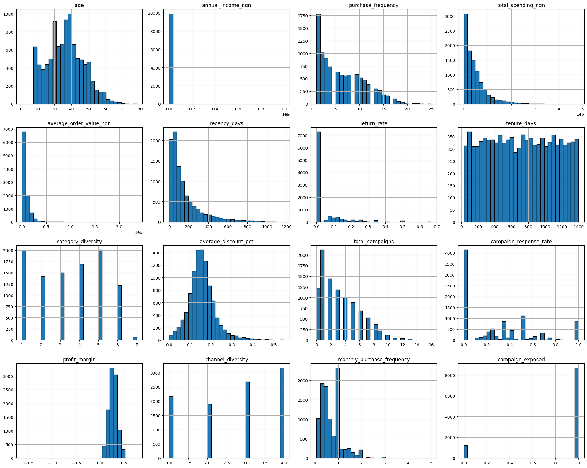

The histograms revealed that some features had positively skewed distributions. The annual income histogram was particularly compressed near zero because of an extremely large observation stretching the horizontal axis.

This required further investigation before applying any transformation.

**Investigating Annual Income Distribution**

Descriptive statistics were calculated to examine the income distribution, including its lower and upper percentiles.

Python code:
```python
income_summary = X_preprocessed['annual_income_ngn'].describe(
    percentiles=[0.01, 0.05, 0.25, 0.50, 0.75, 0.95, 0.99]
)

income_summary
```

Results:
| Statistic | Annual Income (NGN) |
|---|---:|
| Count | 9,912 |
| Mean | 3,959,664 |
| Standard deviation | 34,716,710 |
| Minimum | 350,000 |
| 1st percentile | 656,458 |
| 5th percentile | 960,507 |
| 25th percentile | 1,667,534 |
| Median | 2,378,022 |
| 75th percentile | 3,390,524 |
| 95th percentile | 5,827,999 |
| 99th percentile | 8,645,892 |
| Maximum | 1,000,000,000 |

The maximum income value of approximately ₦1 billion was substantially higher than the 99th percentile of approximately ₦8.65 million.

The 15 largest income observations were also inspected.
```python
X_preprocessed['annual_income_ngn'].nlargest(15)
```

The inspection revealed 12 observations with an exact value of ₦999,999,999, followed by observations of ₦18 million.
The 12 identical extreme values were treated as confirmed data anomalies rather than genuine customer income observations.

**Measuring Feature Skewness**

Skewness was calculated across the numerical features to identify variables requiring transformation.

Python code:
```python
skewness = X_preprocessed.skew(numeric_only=True)

skewness = skewness.sort_values(ascending=False)

skewness
```

Results:
| Feature | Skewness |
|---|---:|
| annual_income_ngn | 28.600 |
| average_order_value_ngn | 6.808 |
| return_rate | 2.782 |
| total_spending_ngn | 2.235 |
| recency_days | 2.038 |
| monthly_purchase_frequency | 1.471 |
| average_discount_pct | 1.132 |
| campaign_response_rate | 0.937 |
| total_campaigns | 0.917 |
| purchase_frequency | 0.711 |
| age | 0.256 |
| tenure_days | 0.006 |
| category_diversity | -0.014 |
| channel_diversity | -0.270 |
| profit_margin | -1.567 |
| campaign_exposed | -2.287 |

Annual income had the highest positive skewness, largely influenced by the confirmed extreme values. Other features, particularly average order value, return rate, total spending, and recency, also showed positive skewness.

**Correcting Confirmed Annual Income Anomalies**

The 12 observations with an income value of ₦999,999,999 were flagged and replaced with missing values.

An audit column, income_error, was also created to preserve information about the affected records.

Python code:
```python
# Identify the confirmed anomalous income values
income_error_mask = (
    X_preprocessed['annual_income_ngn'] == 999_999_999
)

# Create an audit flag
X_preprocessed['income_error'] = income_error_mask.astype(int)

# Replace confirmed errors with NaN
X_preprocessed.loc[
    income_error_mask, 'annual_income_ngn'
] = np.nan

# Check the correction
print("Flagged records:", income_error_mask.sum())
print(
    "Missing income values:",
    X_preprocessed['annual_income_ngn'].isna().sum()
)
```

Results:
| Metric | Result |
|---|---:|
| Flagged records | 12 |
| Missing income values created | 12 |

The correction prevented the extreme observations from distorting subsequent transformations.

**Reassessing Income Distribution After Correction**

The income statistics and skewness were recalculated after removing the confirmed anomalies.

Python code:
```python
print(
    X_preprocessed['annual_income_ngn'].describe(
        percentiles=[0.01, 0.05, 0.25, 0.50, 0.75, 0.95, 0.99]
    )
)

print(
    "\nIncome skewness:",
    X_preprocessed['annual_income_ngn'].skew()
)
```

Results:
| Statistic | Annual Income (NGN) |
|---|---:|
| Count | 9,900 |
| Mean | 2,752,342 |
| Standard deviation | 1,609,547 |
| Minimum | 350,000 |
| 1st percentile | 656,389 |
| 5th percentile | 960,474 |
| 25th percentile | 1,667,330 |
| Median | 2,378,022 |
| 75th percentile | 3,387,924 |
| 95th percentile | 5,801,045 |
| 99th percentile | 8,379,819 |
| Maximum | 18,000,000 |

Skewness substantially reduced

Before correction: 28.600

After correction: 1.947

The correction substantially reduced the income skewness. However, the distribution remained positively skewed, making it a suitable candidate for logarithmic transformation.

The corrected income distribution was also visualised.
```python
plt.figure(figsize=(8, 5))

sns.histplot(
    X_preprocessed['annual_income_ngn'].dropna(),
    bins=40,
    kde=True
)

plt.title('Annual Income Distribution After Anomaly Correction')
plt.xlabel('Annual Income (NGN)')
plt.show()
```

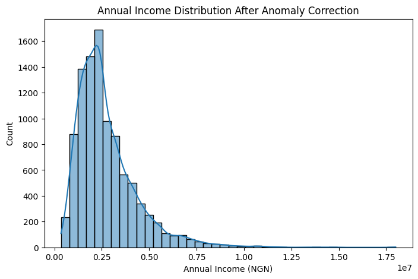

**Applying Logarithmic Transformation**

Logarithmic transformation was applied to selected positively skewed features to reduce the influence of large values and make their distributions more manageable.

The np.log1p() function was used because it calculates the natural logarithm of one plus the original value.

A separate working copy was created to preserve the preceding dataset.

Python code:
```python
X_transformed = X_preprocessed.copy()

log_features = [
    'annual_income_ngn',
    'total_spending_ngn',
    'average_order_value_ngn',
    'recency_days',
    'monthly_purchase_frequency'
]

for col in log_features:
    X_transformed[col] = np.log1p(X_transformed[col])

X_transformed[log_features].skew().sort_values(
    ascending=False
)
```

Results:
| Feature | Skewness After Transformation |
|---|---:|
| monthly_purchase_frequency | 0.602 |
| average_order_value_ngn | 0.087 |
| annual_income_ngn | -0.017 |
| recency_days | -0.150 |
| total_spending_ngn | -0.744 |

The logarithmic transformation substantially reduced the skewness of the selected features.

Annual income became approximately symmetric, while average order value and recency also showed considerable improvements.

**Checking Missing and Infinite Values**

Following the logarithmic transformation, the dataset was checked for missing and infinite values.

Python code:
```python
print("Missing values:", X_transformed.isnull().sum().sum())

print(
    "Infinite values:",
    np.isinf(
        X_transformed.select_dtypes(include=np.number)
    ).sum().sum()
)
```

Results:
| Assessment | Result |
|---|---:|
| Missing values | 12 |
| Infinite values | 0 |

The 12 missing values were the annual income observations deliberately replaced during anomaly correction.

**Imputing the Remaining Income Values**

Median imputation was applied to the 12 missing annual income values.

The median was preferred because it is less sensitive to extreme observations than the mean.

Python code:
```python
# Calculate median annual income
income_median = X_transformed['annual_income_ngn'].median()

# Impute missing income values
X_transformed['annual_income_ngn'] = (
    X_transformed['annual_income_ngn'].fillna(income_median)
)

# Verify
print("Missing values:", X_transformed.isnull().sum().sum())
print("Income median used:", income_median)
```

Results:
| Metric | Result |
|---|---:|
| Missing values after imputation | 0 |
| Median used | 14.681780 |

The median of 14.681780 represents the transformed income scale, not the original income in naira.

**Final Dataset Validation**

The transformed dataset was validated to confirm its dimensions and ensure that no missing or infinite values remained.

Python code:
```python
print("Dataset shape:", X_transformed.shape)

print("\nMissing values:")
print(X_transformed.isnull().sum().sum())

print("\nInfinite values:")
print(
    np.isinf(
        X_transformed.select_dtypes(include=np.number)
    ).sum().sum()
)
```

Results:

The final dataset contained 9,912 customers and 17 columns, with no missing or infinite values.

Important: The 17 columns include the 15 selected clustering features, the campaign_exposed indicator, and the income_error audit flag. The audit flag should not automatically be included in K-Means.

**Feature Transformation Summary**

The transformation stage addressed the distributional issues identified during feature inspection.
| Stage | Action |
|---|---|
| Distribution analysis | Examined numerical feature histograms |
| Income investigation | Identified 12 extreme income observations |
| Anomaly correction | Replaced confirmed income errors with missing values |
| Log transformation | Applied log1p() to five selected features |
| Missing-value treatment | Median-imputed transformed income |
| Validation | Confirmed zero missing and infinite values |

The resulting X_transformed dataset is ready for the next preprocessing stage: feature scaling.

## FEATURE SCALING

After feature transformation, the next step was to standardise the selected clustering features.

The selected variables have different measurement scales. For example, age is measured in years, income and spending are monetary values, while return rate and profit margin are proportions.

Since K-Means uses distance calculations to determine customer similarity, variables with larger numerical ranges could disproportionately influence the clustering results.

To prevent this, StandardScaler was applied to the continuous numerical features.

The binary campaign_exposed feature was deliberately excluded from scaling so that its original 0 and 1 values would be preserved.

**Separating Continuous and Binary Features**

The audit column income_error was first removed because it was created for data-quality tracking and was not intended to represent customer behaviour.

The remaining features were divided into:
- Continuous features: the 15 numerical customer-behaviour and demographic variables.
- Binary feature: campaign_exposed, representing whether a customer had recorded campaign exposure.
  
Python code:
```python
from sklearn.preprocessing import StandardScaler

# Remove audit columns from clustering features
model_features = X_transformed.drop(
    columns=['income_error'],
    errors='ignore'
).copy()

# Separate binary feature
binary_features = ['campaign_exposed']

continuous_features = [
    col for col in model_features.columns
    if col not in binary_features
]
```

This separation ensured that the continuous features could be standardised without changing the interpretation of the binary campaign exposure indicator.

**Applying StandardScaler**

StandardScaler was used to standardise the continuous features.

After transformation, each continuous feature has an approximate mean of zero and standard deviation of one.

Python code:
```python
# Scale continuous features
scaler = StandardScaler()

X_scaled_continuous = pd.DataFrame(
    scaler.fit_transform(model_features[continuous_features]),
    columns=continuous_features,
    index=model_features.index
)

# Recombine with the original binary feature
X_scaled = pd.concat(
    [
        X_scaled_continuous,
        model_features[binary_features]
    ],
    axis=1
)

# Preserve the original feature order
X_scaled = X_scaled[model_features.columns]
```

The original binary values of campaign_exposed were retained without standardisation.

**Validating the Scaled Dataset**

The scaled dataset was inspected to confirm its dimensions, feature means, standard deviations, and missing-value count.

Python code:
```python
print("Dataset shape:", X_scaled.shape)

print("\nFeature means:")
print(X_scaled[continuous_features].mean().round(3))

print("\nFeature standard deviations:")
print(X_scaled[continuous_features].std().round(3))

print("\nMissing values:", X_scaled.isnull().sum().sum())
```

Results:
The results confirmed that all 15 continuous features had been successfully standardised. Their means were approximately zero, and their standard deviations were approximately one.

The final dataset retained all 9,912 customers and 16 features, with no missing values.

**Feature Scaling Summary**
| Item | Treatment |
|---|---|
| Scaling method | StandardScaler |
| Continuous features | 15 |
| Binary features | 1 |
| Binary feature | campaign_exposed |
| Audit columns | Removed |
| Final dataset shape | (9,912, 16) |
| Missing values | 0 |

**Conclusion**

Feature scaling was successfully completed. The continuous features now share a common scale, while the binary campaign exposure feature retains its original 0 and 1 values.

The resulting X_scaled dataset is the standardised input for the next stage: Principal Component Analysis (PCA).

## PRINCIPAL COMPONENT ANALYSIS (PCA)

After feature scaling, Principal Component Analysis (PCA) was applied to reduce the dimensionality of the customer dataset while preserving as much information as possible.

The scaled dataset contained 16 features. Although these features represented different aspects of customer behaviour, some relationships existed between them.

PCA transforms the original variables into a smaller set of new variables called principal components. These components capture the maximum possible variance in the data while being uncorrelated with one another.

The objectives were to:
- Reduce the number of dimensions entering K-Means.
- Retain as much information as possible from the original features.
- Reduce the effect of overlapping information.
- Produce a more compact representation of customer behaviour for clustering.

**Applying PCA to the Scaled Dataset**

PCA was initially performed without specifying the number of components. This allowed the algorithm to calculate the explained variance of all 16 possible principal components.

Python code:
```python
from sklearn.decomposition import PCA

# Initialize PCA
pca = PCA()

# Fit and transform the scaled dataset
X_pca = pca.fit_transform(X_scaled)

# Explained variance
explained_variance = pca.explained_variance_ratio_

# Cumulative explained variance
cumulative_variance = np.cumsum(explained_variance)

# Create summary table
pca_summary = pd.DataFrame({
    'Principal Component': [
        f'PC{i+1}' for i in range(len(explained_variance))
    ],
    'Explained Variance': explained_variance,
    'Cumulative Variance': cumulative_variance
})

pca_summary
```

**Explained Variance Analysis**

The explained variance ratio indicates the proportion of the total variation in the original dataset captured by each principal component.

The cumulative explained variance shows how much information is retained as additional components are included.

Results:
| Principal Component | Explained Variance | Cumulative Variance |
|---|---:|---:|
| PC1 | 29.79% | 29.79% |
| PC2 | 12.30% | 42.09% |
| PC3 | 9.39% | 51.48% |
| PC4 | 6.87% | 58.35% |
| PC5 | 6.67% | 65.02% |
| PC6 | 6.58% | 71.60% |
| PC7 | 6.51% | 78.12% |
| PC8 | 6.21% | 84.33% |
| PC9 | 5.85% | 90.18% |
| PC10 | 4.03% | 94.21% |
| PC11 | 2.04% | 96.25% |
| PC12 | 1.60% | 97.85% |
| PC13 | 1.07% | 98.91% |
| PC14 | 0.60% | 99.52% |
| PC15 | 0.39% | 99.91% |
| PC16 | 0.09% | 100.00% |

The first principal component explained approximately 29.79% of the total variance, while the first nine components collectively explained approximately 90.18%.

This indicated that a substantial proportion of the information in the original 16-dimensional dataset could be represented using nine principal components.

**Visualising Cumulative Explained Variance**

A cumulative explained variance plot was generated to determine how many principal components were required to retain different levels of information.

Python code:
```python
plt.figure(figsize=(10, 6))

plt.plot(
    range(1, len(cumulative_variance) + 1),
    cumulative_variance,
    marker='o'
)

plt.axhline(
    y=0.80,
    linestyle='--',
    label='80% variance'
)

plt.axhline(
    y=0.90,
    linestyle='--',
    label='90% variance'
)

plt.xlabel('Number of Principal Components')
plt.ylabel('Cumulative Explained Variance')
plt.title('PCA - Cumulative Explained Variance')
plt.xticks(range(1, len(cumulative_variance) + 1))
plt.legend()
plt.grid(alpha=0.3)
plt.show()
```
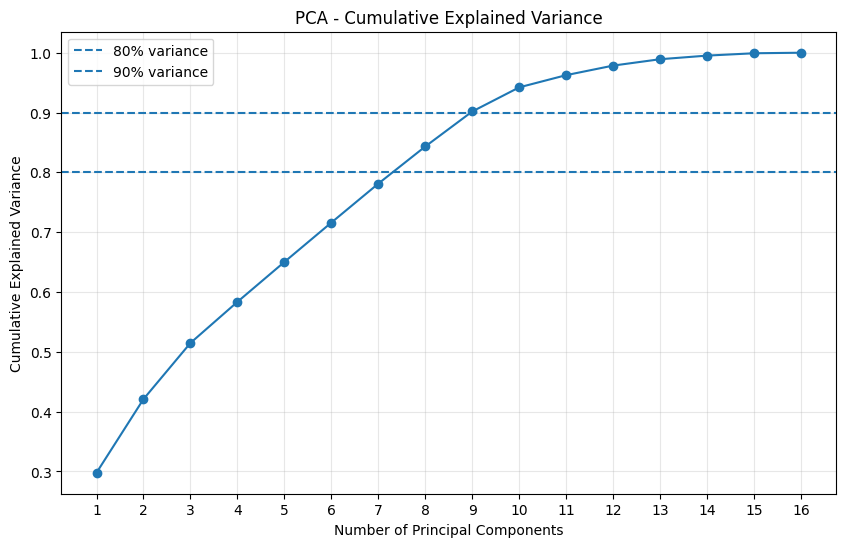

The plot showed that:
- Seven components retained approximately 78.12% of the variance.
- Eight components retained approximately 84.33%.
- Nine components retained approximately 90.18%.
- 
Nine components were therefore selected to retain more than 90% of the information represented by the original features.

**PCA Scree Plot**

A scree plot was also generated to examine the individual contribution of each principal component.

Python code:
```python
plt.figure(figsize=(10, 6))

plt.plot(
    range(1, len(explained_variance) + 1),
    explained_variance,
    marker='o'
)

plt.xlabel('Principal Component')
plt.ylabel('Explained Variance Ratio')
plt.title('PCA Scree Plot')
plt.xticks(range(1, len(explained_variance) + 1))
plt.grid(alpha=0.3)

plt.show()
```

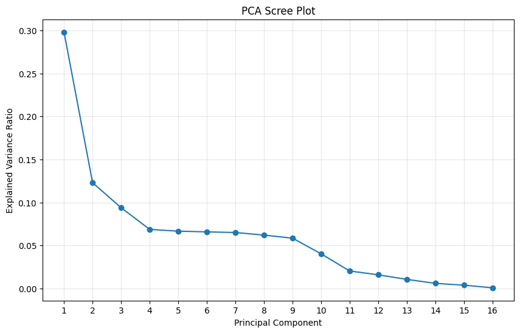

The scree plot provided a visual representation of how much variance each additional component contributed. The explained variance generally decreased as more components were introduced.

Together, the cumulative variance plot and scree plot supported the decision to retain nine components.

**Creating the Reduced PCA Dataset**

After reviewing the explained variance, PCA was configured to retain nine principal components.

Python code:
```python
pca_9 = PCA(n_components=9)

X_pca_9 = pca_9.fit_transform(X_scaled)

print("Original feature shape:", X_scaled.shape)
print("PCA feature shape:", X_pca_9.shape)

print(
    "Total explained variance:",
    round(pca_9.explained_variance_ratio_.sum() * 100, 2),
    "%"
)
```

Results:
| Metric | Result |
|---|---:|
| Original dataset shape | (9,912, 16) |
| Reduced dataset shape | (9,912, 9) |
| Original features | 16 |
| Principal components retained | 9 |
| Explained variance retained | 90.18% |

The dataset was reduced from 16 original features to nine principal components, representing a reduction of approximately 43.75% in dimensionality while retaining 90.18% of the total variance.

**Final PCA Validation**

Before proceeding to K-Means, the reduced dataset was checked to confirm its dimensions, retained variance, and missing-value status.

Python code:
```python
print("Original feature shape:", X_scaled.shape)
print("Reduced feature shape:", X_pca_9.shape)

print(
    "Explained variance retained:",
    round(pca_9.explained_variance_ratio_.sum() * 100, 2),
    "%"
)

print("Missing values:", np.isnan(X_pca_9).sum())
```

Results:
| Validation | Result |
|---|---:|
| Original dataset | (9,912, 16) |
| Reduced dataset | (9,912, 9) |
| Explained variance | 90.18% |
| Missing values | 0 |

The validation confirmed that the PCA transformation was successful and that the reduced dataset contained no missing values.

**PCA Summary**

PCA successfully reduced the dimensionality of the customer dataset while retaining most of its information.
| Item | Final Result |
|---|---|
| Input dataset | X_scaled |
| Original dimensions | 16 |
| PCA method | Principal Component Analysis |
| Components retained | 9 |
| Variance retained | 90.18% |
| Output dataset | X_pca_9 |
| Final dimensions | 9,912 × 9 |
| Missing values | 0 |

**Conclusion**

The nine-component PCA dataset retained approximately 90.18% of the variance from the original 16 features. This provided a more compact representation of customer behaviour for the next stage of analysis.
The resulting X_pca_9 dataset is ready for K-Means clustering.

## CUSTOMER SEGMENTATION USING K-MEANS CLUSTERING

After completing feature selection, transformation, scaling, and dimensionality reduction, K-Means clustering was applied to identify groups of customers with similar behavioural characteristics.

The clustering algorithm used the reduced PCA dataset, X_pca_9, containing 9,912 customers represented by nine principal components.

The objectives were to:
- Determine an appropriate number of customer segments.
- Group customers based on similarities in their purchasing and behavioural patterns.
- Examine the characteristics of the resulting clusters.
- Evaluate the quality of the segmentation.
- Assign cluster labels to the customer-level dataset for further business interpretation.

**Determining the Optimal Number of Clusters**

The Elbow Method and Silhouette Score were used to investigate suitable values of K.

The Elbow Method evaluates how the within-cluster sum of squared distances (inertia) decreases as the number of clusters increases.

The Silhouette Score measures how well customers fit within their assigned clusters compared with neighbouring clusters. Higher scores generally indicate better-defined clusters.

The analysis tested values of K from 2 to 10.

Python code:
```python
from sklearn.cluster import KMeans
from sklearn.metrics import silhouette_score

inertia_scores = []
silhouette_scores = []

k_values = range(2, 11)

for k in k_values:

    kmeans = KMeans(
        n_clusters=k,
        random_state=42,
        n_init=20
    )

    cluster_labels = kmeans.fit_predict(X_pca_9)

    inertia_scores.append(kmeans.inertia_)

    silhouette = silhouette_score(
        X_pca_9,
        cluster_labels,
        sample_size=3000,
        random_state=42
    )

    silhouette_scores.append(silhouette)

    print(
        f"K={k} | "
        f"Inertia={kmeans.inertia_:.2f} | "
        f"Silhouette={silhouette:.4f}"
    )
```

Results:
| Number of Clusters (K) | Inertia | Silhouette Score |
|---:|---:|---:|
| 2 | 102,169.30 | 0.2334 |
| 3 | 92,329.18 | 0.1654 |
| 4 | 86,001.88 | 0.1453 |
| 5 | 80,705.14 | 0.1512 |
| 6 | 76,714.07 | 0.1431 |
| 7 | 73,500.76 | 0.1408 |
| 8 | 70,653.92 | 0.1190 |
| 9 | 68,227.55 | 0.1121 |
| 10 | 66,034.45 | 0.1142 |

The results showed that inertia decreased as the number of clusters increased, which is expected because adding more clusters generally reduces within-cluster distances.

The highest Silhouette Score was obtained at K=2, with a score of 0.2334. However, the score declined when additional clusters were introduced, indicating that increasing the number of clusters did not improve the overall separation of the groups according to this metric.

**Visualising the Elbow Method and Silhouette Scores**

Both evaluation methods were visualised to compare their behaviour across the tested cluster values.

Python code:
```python
fig, axes = plt.subplots(1, 2, figsize=(15, 5))

# Elbow Method
axes[0].plot(
    list(k_values),
    inertia_scores,
    marker='o'
)
axes[0].set_title('Elbow Method')
axes[0].set_xlabel('Number of Clusters (K)')
axes[0].set_ylabel('Inertia')
axes[0].grid(alpha=0.3)

# Silhouette Score
axes[1].plot(
    list(k_values),
    silhouette_scores,
    marker='o'
)
axes[1].set_title('Silhouette Score')
axes[1].set_xlabel('Number of Clusters (K)')
axes[1].set_ylabel('Silhouette Score')
axes[1].grid(alpha=0.3)

plt.tight_layout()
plt.show()
```

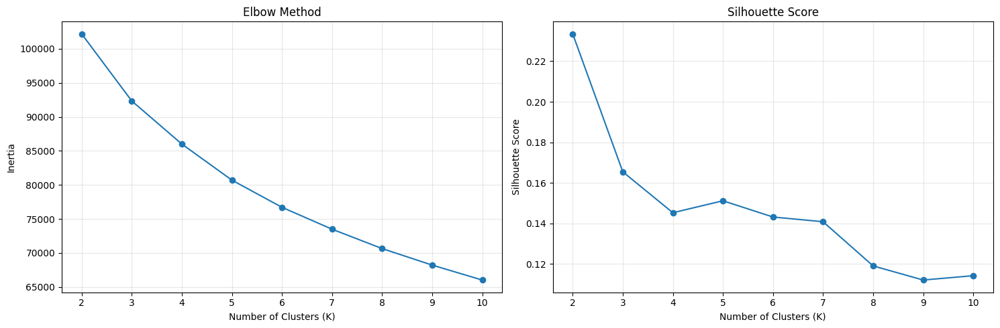

The plots confirmed that K=2 produced the highest Silhouette Score. However, the Elbow Method did not provide an overwhelmingly distinct cluster count from the supplied results.

Therefore, K=2 and K=3 were selected for further investigation rather than relying exclusively on the numerical scores.

**Comparing Cluster Sizes for K=2 and K=3**

The cluster distributions were examined to determine how customers would be divided under the two candidate solutions.

Python code:
```python
# Fit K-Means with 2 clusters
kmeans_2 = KMeans(
    n_clusters=2,
    random_state=42,
    n_init=20
)

labels_2 = kmeans_2.fit_predict(X_pca_9)

# Fit K-Means with 3 clusters
kmeans_3 = KMeans(
    n_clusters=3,
    random_state=42,
    n_init=20
)

labels_3 = kmeans_3.fit_predict(X_pca_9)

# Compare cluster sizes
cluster_comparison = pd.DataFrame({
    'K=2': pd.Series(labels_2).value_counts().sort_index(),
    'K=3': pd.Series(labels_3).value_counts().sort_index()
})

print(cluster_comparison)
```

Results:
| Cluster | K=2 | K=3 |
|---:|---:|---:|
| 0 | 4,463 | 2,990 |
| 1 | 5,449 | 4,219 |
| 2 | — | 2,703 |
| **Total** | **9,912** | **9,912** |

Both solutions produced reasonably populated clusters without extremely small groups.

The K=2 solution divided customers into two broad groups, while K=3 provided an additional group that could potentially reveal more specific customer behaviour.

The distributions were visualised below.

```python
fig, axes = plt.subplots(1, 2, figsize=(13, 5))

cluster_comparison['K=2'].plot(
    kind='bar', ax=axes[0]
)
axes[0].set_title('Customer Distribution: K=2')
axes[0].set_xlabel('Cluster')
axes[0].set_ylabel('Number of Customers')

cluster_comparison['K=3'].plot(
    kind='bar', ax=axes[1]
)
axes[1].set_title('Customer Distribution: K=3')
axes[1].set_xlabel('Cluster')
axes[1].set_ylabel('Number of Customers')

plt.tight_layout()
plt.show()
```
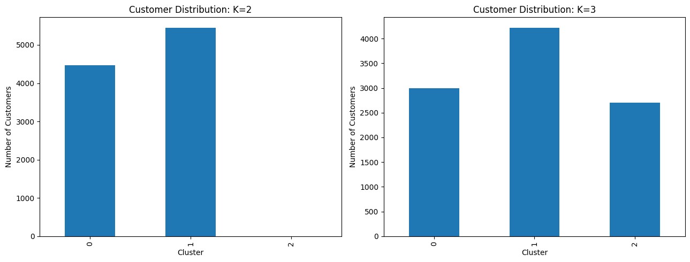

**Profiling the K=2 Clusters**

Cluster profiling was performed using the original customer-level features rather than the PCA components.

This made it possible to interpret the clusters using familiar business variables such as purchase frequency, spending, recency, product diversity, and marketing engagement.

Python code:
```python
# Create a profiling dataset
profile_df = clustering_df[selected_features].copy()

# Assign K=2 cluster labels
profile_df['cluster'] = labels_2

# Calculate average feature values per cluster
cluster_profile_2 = profile_df.groupby('cluster').mean().T

display(cluster_profile_2)
```

Results:
| Feature | Cluster 0 | Cluster 1 |
|---|---:|---:|
| Age | 36.32 | 36.39 |
| Annual income (NGN) | 4,322,086 | 3,662,822 |
| Purchase frequency | 2.22 | 9.61 |
| Total spending (NGN) | 170,402 | 717,395 |
| Average order value (NGN) | 80,511 | 82,381 |
| Recency (days) | 248.48 | 88.97 |
| Return rate | 3.79% | 4.67% |
| Tenure (days) | 639.86 | 772.67 |
| Category diversity | 1.84 | 4.72 |
| Average discount | 15.87% | 15.71% |
| Total campaigns | 1.12 | 5.02 |
| Campaign response rate | 30.57% | 33.32% |
| Profit margin | 28.28% | 26.23% |
| Channel diversity | 1.67 | 3.53 |
| Monthly purchase frequency | 0.76 | 0.66 |

Cluster 0 generally contained customers with lower purchase frequency, lower total spending, fewer product categories, and longer purchasing recency.

Cluster 1 contained customers with higher purchase frequency, substantially greater total spending, broader product preferences, and more campaign exposure.

This indicated that the two-cluster solution primarily distinguished customers with relatively low purchasing activity from those with stronger overall purchasing activity.

**Profiling the K=3 Clusters**

The three-cluster solution was investigated to determine whether it provided more detailed behavioural distinctions.

Python code:
```python
# Create a profiling dataset using original features
profile_df_3 = clustering_df[selected_features].copy()

# Assign K=3 cluster labels
profile_df_3['cluster'] = labels_3

# Calculate mean feature values per cluster
cluster_profile_3 = profile_df_3.groupby('cluster').mean().T

display(cluster_profile_3)
```

Results:
| Feature | Cluster 0 | Cluster 1 | Cluster 2 |
|---|---:|---:|---:|
| Age | 36.26 | 36.44 | 36.36 |
| Annual income (NGN) | 4,754,979 | 3,451,356 | 3,873,300 |
| Purchase frequency | 4.20 | 10.70 | 1.69 |
| Total spending (NGN) | 440,901 | 736,853 | 89,721 |
| Average order value (NGN) | 118,207 | 71,553 | 56,564 |
| Recency (days) | 223.83 | 68.88 | 234.51 |
| Return rate | 5.68% | 4.36% | 2.58% |
| Tenure (days) | 908.78 | 722.38 | 481.32 |
| Category diversity | 2.99 | 4.99 | 1.46 |
| Average discount | 15.76% | 15.72% | 15.91% |
| Total campaigns | 2.12 | 5.62 | 0.85 |
| Campaign response rate | 35.21% | 32.68% | 26.69% |
| Profit margin | 26.29% | 26.36% | 29.34% |
| Channel diversity | 2.53 | 3.65 | 1.37 |
| Monthly purchase frequency | 0.37 | 0.75 | 1.00 |

The three clusters showed more distinct behavioural patterns.
- Cluster 0: Customers with moderate purchase frequency, relatively high average order value, and substantial customer tenure. Their average recency was relatively high, suggesting that many had not purchased recently.
- Cluster 1: Customers with the highest purchase frequency, highest total spending, broadest category diversity, and greatest channel diversity. They also had the lowest average recency.
- Cluster 2: Customers with the lowest purchase frequency, lowest total spending, limited product and channel diversity, and fewer recorded campaign interactions.

These differences suggested that K=3 offered a more detailed customer segmentation structure.

**Comparing Cluster Median Values**

Because means can be influenced by extreme observations, cluster medians were also calculated to provide another perspective on the typical customer in each group.

Python code:
```python
cluster_median_3 = profile_df_3.groupby('cluster').median().T

display(cluster_median_3)
Selected median results:
```

| Feature | Cluster 0 | Cluster 1 | Cluster 2 |
|---|---:|---:|---:|
| Purchase frequency | 4 | 10 | 1 |
| Total spending (NGN) | 300,342 | 574,084 | 56,189 |
| Average order value (NGN) | 77,971 | 52,076 | 35,155 |
| Recency (days) | 178 | 52 | 151 |
| Category diversity | 3 | 5 | 1 |
| Total campaigns | 2 | 5 | 1 |
| Campaign response rate | 33.33% | 33.33% | 0% |
| Channel diversity | 3 | 4 | 1 |

The median results reinforced the differences observed in the mean profiles.

Cluster 1 had the highest typical purchase frequency and spending, while Cluster 2 had the lowest. Cluster 0 occupied an intermediate position in several purchasing measures.

The median profile also showed that the typical customer in Cluster 2 had a campaign response rate of zero. This should be interpreted alongside campaign exposure, because customers without campaign exposure were assigned a response rate of zero during preprocessing.

**Visualising the Three Customer Segments**

The three-cluster solution was visualised using the first two principal components.

Although the clustering model used all nine principal components, the first two components provided a two-dimensional representation of the customer distribution.

Python code:
```python
plt.figure(figsize=(10, 7))

plt.scatter(
    X_pca_9[:, 0],
    X_pca_9[:, 1],
    c=labels_3,
    cmap='viridis',
    alpha=0.5,
    s=15
)

plt.title('K-Means Customer Segmentation (K=3)')
plt.xlabel('Principal Component 1')
plt.ylabel('Principal Component 2')
plt.colorbar(label='Customer Cluster')

plt.show()
```

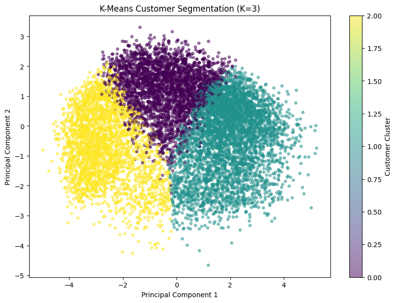

The plot provided a visual representation of how the three customer groups were distributed across the first two principal components.

It is important to note that this is a two-dimensional projection of a nine-dimensional clustering solution. Consequently, some overlap in the scatter plot does not necessarily mean that the clusters overlap to the same extent in the full PCA space.

**Selecting the K=3 Model**

Although K=2 produced the highest Silhouette Score, K=3 was selected as the provisional segmentation model because its cluster profiles revealed three more actionable behavioural groups.
The decision was based on the combination of:
- Cluster population distribution.
- Differences in purchasing frequency and spending.
- Differences in recency and product diversity.
- Differences in channel usage and campaign engagement.
- The business usefulness of distinguishing three customer groups rather than two broad categories.

This was a business-oriented modelling decision, not evidence that K=3 was mathematically superior to K=2.

The three-cluster solution therefore became the candidate model for subsequent evaluation and business interpretation.

**Fitting the Final Candidate K-Means Model**

The K-Means model was fitted again using three clusters. The resulting cluster labels were attached to the original customer-level dataset.

Python code:
```python
# Initialize the final candidate K-Means model
final_kmeans = KMeans(
    n_clusters=3,
    random_state=42,
    n_init=20
)

# Fit model and generate cluster labels
final_labels = final_kmeans.fit_predict(X_pca_9)

# Attach cluster labels to customer-level data
customer_segments = clustering_df.copy()

customer_segments['cluster'] = final_labels

# Verify cluster distribution
print(customer_segments['cluster'].value_counts().sort_index())

print("\nDataset shape:", customer_segments.shape)
print("Unique customers:", customer_segments['customer_id'].nunique())
```

Results:
| Cluster | Number of Customers | Percentage |
|---|---:|---:|
| Cluster 0 | 2,990 | 30.17% |
| Cluster 1 | 4,219 | 42.57% |
| Cluster 2 | 2,703 | 27.26% |
| **Total** | **9,912** | **100%** |

The resulting customer_segments dataset contained all 9,912 customers, their original customer-level features, and an additional cluster column.

**Evaluating the Final K-Means Model**

Three clustering evaluation metrics were used to assess the final candidate model:
1.	Silhouette Score: Measures how well-separated the clusters are. Higher values are generally better.
2.	Davies-Bouldin Index: Measures similarity between clusters based on within-cluster dispersion and separation. Lower values are generally better.
3.	Calinski-Harabasz Index: Measures the ratio of between-cluster dispersion to within-cluster dispersion. Higher values generally indicate better-defined clusters.

Python code:
```python
from sklearn.metrics import (
    silhouette_score,
    davies_bouldin_score,
    calinski_harabasz_score
)

# Evaluate final K-Means model
silhouette = silhouette_score(
    X_pca_9,
    final_labels,
    sample_size=3000,
    random_state=42
)

db_index = davies_bouldin_score(
    X_pca_9,
    final_labels
)

ch_index = calinski_harabasz_score(
    X_pca_9,
    final_labels
)

# Display evaluation results
evaluation_results = pd.DataFrame({
    'Metric': [
        'Silhouette Score',
        'Davies-Bouldin Index',
        'Calinski-Harabasz Index'
    ],
    'Score': [
        silhouette,
        db_index,
        ch_index
    ]
})

display(evaluation_results)
```

Results:
| Evaluation Metric | Score | General Interpretation |
|---|---:|---|
| Silhouette Score | 0.165446 | Relatively weak cluster separation |
| Davies-Bouldin Index | 2.039151 | Indicates overlap or dispersion between clusters |
| Calinski-Harabasz Index | 2,292.306932 | Measures separation relative to within-cluster dispersion |

The Silhouette Score of 0.1654 indicates that the clusters are not strongly separated. This suggests that some customers have behavioural characteristics that overlap across the assigned segments.

The Davies-Bouldin Index provides an additional indication that the clusters are not perfectly distinct.

These results do not invalidate the segmentation, but they indicate that the customer groups should be interpreted as broad behavioural patterns rather than completely separate customer types.

**K-Means Clustering Summary**

The K-Means algorithm successfully grouped 9,912 customers into three clusters using nine principal components.

| Item | Result |
|---|---|
| Clustering algorithm | K-Means |
| Input dataset | X_pca_9 |
| Number of customers | 9,912 |
| Number of PCA components | 9 |
| Selected clusters | 3 |
| Random state | 42 |
| Initialisations (n_init) | 20 |
| Silhouette Score | 0.165446 |
| Davies-Bouldin Index | 2.039151 |
| Calinski-Harabasz Index | 2,292.306932 |
| Output dataset | customer_segments |

**Conclusion**

The K-Means model produced three customer segments with distinct differences in purchasing activity, spending, recency, product diversity, and channel usage.

The cluster profiles suggest the following preliminary interpretations:
- Cluster 0: Moderate-value customers with relatively high average order values but less recent purchasing activity.
- Cluster 1: Highly active customers with the greatest purchasing frequency, total spending, and behavioural diversity.
- Cluster 2: Low-activity customers with lower spending, limited product diversity, and fewer campaign interactions.

K=3 was retained as the candidate model because it provided more detailed and potentially actionable customer profiles than K=2, despite having a lower Silhouette Score.

## CUSTOMER CLUSTER PROFILING

After fitting the final K-Means model, the three clusters were profiled using their mean and median values across eight key behavioural features. This provides a clearer understanding of how customers in each cluster differ in purchasing activity, spending, recency, product preferences, marketing engagement, and sales channel usage.

Python code:
```python
key_features = [
    'purchase_frequency',
    'total_spending_ngn',
    'average_order_value_ngn',
    'recency_days',
    'category_diversity',
    'total_campaigns',
    'campaign_response_rate',
    'channel_diversity'
]

cluster_summary = customer_segments.groupby('cluster')[
    key_features
].agg(['mean', 'median'])

display(cluster_summary.round(2))
```

Cluster profiling results:
| Behavioural feature | Cluster 0 | Cluster 1 | Cluster 2 |
|---|---:|---:|---:|
| Purchase frequency (mean) | 4.20 | 10.70 | 1.69 |
| Total spending (mean) | ₦440,900.61 | ₦736,852.68 | ₦89,720.96 |
| Average order value (mean) | ₦118,207.25 | ₦71,552.70 | ₦56,564.29 |
| Recency in days (mean) | 223.83 | 68.88 | 234.51 |
| Category diversity (mean) | 2.99 | 4.99 | 1.46 |
| Total campaigns (mean) | 2.12 | 5.62 | 0.85 |
| Campaign response rate (mean) | 0.35 | 0.33 | 0.27 |
| Channel diversity (mean) | 2.53 | 3.65 | 1.37 |

Note: The code calculates both mean and median. The table above presents the mean values for a more compact comparison; the full output also contains the median values.

**Interpretation of cluster profiles**

- Cluster 0 – Moderate-Value Customers: These customers make a moderate number of purchases and generate relatively high average order values. They have a longer average recency of approximately 224 days, suggesting that many have not purchased recently. Their spending and behavioural diversity indicate potential value, but their reduced recent activity may require re-engagement.
- Cluster 1 – High-Activity Customers: This group has the highest purchase frequency, total spending, category diversity, campaign exposure, and channel diversity. Its average recency of approximately 69 days also indicates more recent purchasing activity. These customers represent the most active segment and may be suitable for loyalty programmes, retention initiatives, and cross-selling opportunities.
- Cluster 2 – Low-Activity Customers: These customers have the lowest purchase frequency, spending, average order value, category diversity, and channel diversity. Their limited purchasing activity suggests an opportunity for targeted engagement and campaigns designed to encourage repeat purchases.

**Visualizing Customer Segment Profiles**

A heatmap was created to compare the mean behavioural characteristics of the three clusters. Since the features have different measurement scales, MinMaxScaler was used to normalise the cluster mean values between 0 and 1 for visual comparison.

Python code:
```python
import seaborn as sns
from sklearn.preprocessing import MinMaxScaler

# Calculate cluster mean profiles
heatmap_data = customer_segments.groupby('cluster')[
    key_features
].mean()

# Scale values between 0 and 1
heatmap_scaler = MinMaxScaler()

heatmap_scaled = pd.DataFrame(
    heatmap_scaler.fit_transform(heatmap_data),
    index=heatmap_data.index,
    columns=heatmap_data.columns
)

# Plot heatmap
plt.figure(figsize=(14, 6))

sns.heatmap(
    heatmap_scaled,
    annot=True,
    cmap='YlGnBu',
    fmt='.2f',
    linewidths=0.5
)

plt.title('Customer Segment Behavioural Profile')
plt.xlabel('Customer Behavioural Features')
plt.ylabel('Customer Cluster')

plt.tight_layout()
plt.show()
```

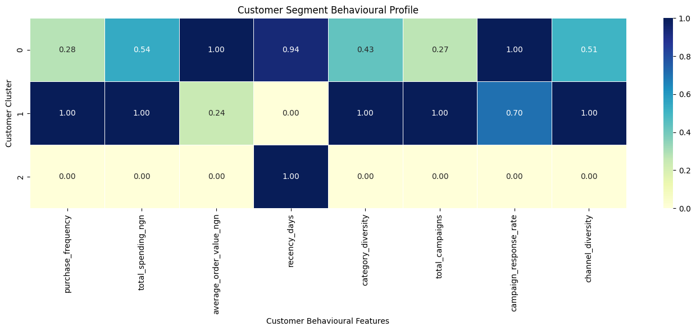

**Interpretation**

The heatmap provides a visual comparison of the relative behavioural profiles of the three customer segments.
- Cluster 0 shows relatively strong average order value and moderate spending and behavioural diversity.
- Cluster 1 demonstrates stronger purchasing activity, spending, product diversity, campaign exposure, and channel usage.
- Cluster 2 generally records lower values across most purchasing and engagement indicators.

The heatmap scaling is performed separately for each feature across the three clusters. Therefore, a value closer to 1 indicates the highest cluster mean for that particular feature, not an absolute performance score or a comparison across different features.

**Overall conclusion**

The cluster profiles reveal three distinguishable customer behaviour groups: moderate-value customers, high-activity customers, and low-activity customers. These profiles provide a basis for developing segment-specific marketing, retention, and customer engagement strategies.

One interpretation caution: Cluster 2's lower campaign response rate should be considered alongside its low campaign exposure. A customer who was not exposed to a campaign should not automatically be interpreted as having ignored or rejected it.

## BUSINESS PERFORMANCE ANALYSIS

After identifying and profiling the three customer segments, the next step was to evaluate their contributions to overall business performance.
The analysis focused on answering two important business questions:
1.	Which customer segment generates the highest revenue?
2.	Which customer segment should receive greater marketing attention?

To answer these questions, the segments were compared using customer count, total revenue, average customer spending, purchase frequency, average order value, and return rate.

Python code:
```python
business_performance = customer_segments.groupby('cluster').agg(
    customer_count=('customer_id', 'nunique'),
    total_revenue=('total_spending_ngn', 'sum'),
    average_customer_spending=('total_spending_ngn', 'mean'),
    average_purchase_frequency=('purchase_frequency', 'mean'),
    average_order_value=('average_order_value_ngn', 'mean'),
    average_return_rate=('return_rate', 'mean')
)

# Calculate customer and revenue contribution
business_performance['customer_percentage'] = (
    business_performance['customer_count']
    / business_performance['customer_count'].sum() * 100
)

business_performance['revenue_percentage'] = (
    business_performance['total_revenue']
    / business_performance['total_revenue'].sum() * 100
)

display(business_performance.round(2))
```

Business performance results:
| Metric | Cluster 0 | Cluster 1 | Cluster 2 |
|---|---:|---:|---:|
| Customer count | 2,990 | 4,219 | 2,703 |
| Total revenue | ₦1.32bn | ₦3.11bn | ₦242.52m |
| Average customer spending | ₦440,900.61 | ₦736,852.68 | ₦89,720.96 |
| Average purchase frequency | 4.20 | 10.70 | 1.69 |
| Average order value | ₦118,207.25 | ₦71,552.70 | ₦56,564.29 |
| Average return rate | 6% | 4% | 3% |
| Customer contribution | 30.17% | 42.56% | 27.27% |
| Revenue contribution | 28.23% | 66.58% | 5.19% |

**Interpretation of business performance**

- Cluster 0: Represents 30.17% of customers and contributes 28.23% of total revenue. Although customers in this segment have the highest average order value, their lower purchase frequency and longer purchase recency limit their overall revenue contribution. Re-engagement campaigns could encourage more frequent purchases.
- Cluster 1: Represents 42.56% of customers but generates 66.58% of total revenue. It has the highest average customer spending and purchase frequency. This is the most commercially valuable segment and should be prioritised for customer retention, loyalty programmes, and personalised cross-selling.
- Cluster 2: Represents 27.27% of customers but contributes only 5.19% of revenue. Its low purchasing frequency and average spending suggest an opportunity for targeted activation campaigns, introductory offers, and strategies to encourage repeat purchases.

**Visualising Revenue Contribution by Customer Segment**

A bar chart was created to compare the total revenue generated by each customer segment.

Python code:
```python
plt.figure(figsize=(9, 5))

sns.barplot(
    data=business_performance.reset_index(),
    x='cluster',
    y='total_revenue'
)

plt.title('Total Revenue Contribution by Customer Segment')
plt.xlabel('Customer Cluster')
plt.ylabel('Total Revenue (NGN)')

plt.tight_layout()
plt.show()
```

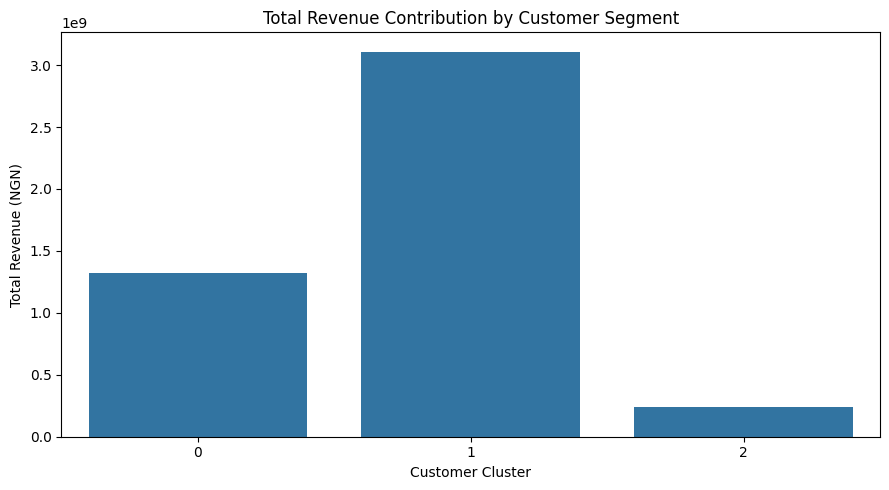

**Interpretation**

The chart shows that Cluster 1 generates substantially more revenue than Clusters 0 and 2. Its revenue contribution is particularly significant because it generates approximately two-thirds of the total revenue while representing less than half of the customer base.

**Comparing Customer Share Against Revenue Share**

To understand the relative business value of each segment, customer percentage and revenue percentage were compared using a grouped bar chart.

Python code:
```python
contribution_data = business_performance[
    ['customer_percentage', 'revenue_percentage']
]

contribution_data.plot(
    kind='bar',
    figsize=(10, 6)
)

plt.title('Customer Share vs Revenue Share by Segment')
plt.xlabel('Customer Cluster')
plt.ylabel('Percentage (%)')
plt.xticks(rotation=0)
plt.legend(['Customer Share', 'Revenue Share'])

plt.tight_layout()
plt.show()
```

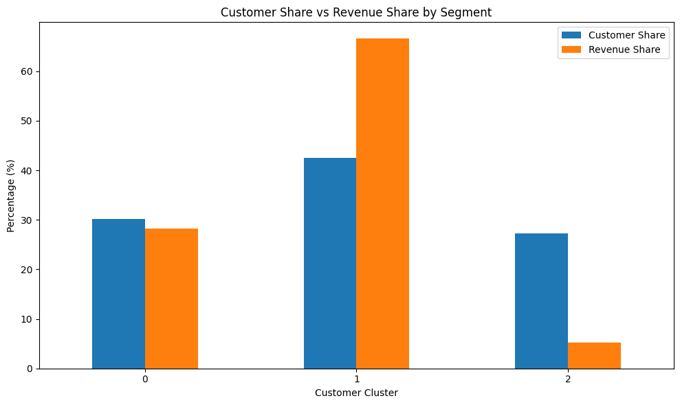

**Interpretation**

The comparison highlights the differences between customer population size and revenue contribution:
- Cluster 1 contributes a significantly higher proportion of revenue (66.58%) than its share of customers (42.56%).
- Cluster 0 contributes 28.23% of revenue from 30.17% of customers.
- Cluster 2 contributes only 5.19% of revenue despite representing 27.27% of customers.

This suggests that customer numbers alone do not determine business value. The frequency and monetary value of customer purchases are important drivers of revenue contribution.

**Business Implications and Marketing Priorities**

Based on the revenue contribution analysis, the following marketing priorities were identified:
| Customer segment | Marketing priority | Recommended strategy |
|---|---|---|
| Cluster 1 | Retention and growth | Loyalty rewards, personalised recommendations, cross-selling, and exclusive offers |
| Cluster 0 | Re-engagement | Win-back campaigns, targeted promotions, and incentives to increase purchase frequency |
| Cluster 2 | Customer activation | First-repeat-purchase incentives, introductory offers, and targeted engagement campaigns |

**Overall conclusion**

Cluster 1 is the strongest revenue-generating segment, contributing 66.58% of total revenue. The business should prioritise retaining these customers while developing strategies to increase their long-term value.

Cluster 0 presents an opportunity to increase revenue through re-engagement and improved purchase frequency, while Cluster 2 requires targeted activation strategies to encourage more customers to become repeat purchasers.

The analysis demonstrates how customer segmentation can support business decisions beyond grouping customers: it helps identify revenue-driving segments and allocate marketing resources more strategically.

Technical note: The revenue figures represent the sum of total_spending_ngn for customers in each cluster, based on completed transactions. They are historical revenue contributions, not forecasts of future revenue. Also, the return rates are averages of customer-level return rates, not the overall transaction-weighted return rate.

## BUSINESS INSIGHTS AND RECOMMENDATIONS

The customer segmentation and business performance analyses revealed three distinct customer groups with different purchasing behaviours and revenue contributions.
Key Business Insights
1.	High-value customers drive revenue: Cluster 1 contributes 66.58% of total revenue from 42.56% of customers. These customers have the highest purchase frequency and average customer spending.
2.	Moderate-value customers offer growth opportunities: Cluster 0 contributes 28.23% of revenue. Despite having the highest average order value, their relatively low purchase frequency and longer recency suggest opportunities to improve customer engagement.
3.	Low-activity customers require activation: Cluster 2 represents 27.27% of customers but contributes only 5.19% of revenue, indicating low purchasing activity and spending.
4.	Customer behaviour varies significantly: Differences in purchase frequency, spending, recency, product diversity, and channel usage demonstrate the importance of targeted customer strategies rather than treating all customers alike.

**Business Recommendations**
| Customer segment | Recommended business strategy |
|---|---|
| Cluster 1 – High-Activity Customers | Prioritise retention through loyalty programmes, personalised offers, and cross-selling. |
| Cluster 0 – Moderate-Value Customers | Use re-engagement campaigns and targeted promotions to increase purchase frequency. |
| Cluster 2 – Low-Activity Customers | Introduce activation campaigns, introductory incentives, and repeat-purchase offers. |

**Overall Recommendation**

The business should prioritise retaining Cluster 1 because it generates the largest share of revenue. At the same time, Cluster 0 should be targeted for increased purchasing activity, while Cluster 2 should receive focused activation campaigns.

Implementing these segment-specific strategies can help improve customer retention, increase purchase frequency, and strengthen overall revenue performance.

## MODEL DEPLOYMENT AND APPLICATION DEVELOPMENT

After completing customer segmentation and evaluating the final K-Means model, the trained model and preprocessing objects were saved for deployment.

**Saving Model Artifacts**

The trained model and essential preprocessing components were packaged into a dictionary and saved using Joblib. This ensures that the same preprocessing steps and trained models can be reused when making predictions on new customer records.

Python code:
```python
import joblib
import os

# Create a folder for model artifacts
os.makedirs("artifacts", exist_ok=True)

# Package the trained model and preprocessing objects
model_artifacts = {
    "scaler": scaler,
    "pca": pca_9,
    "kmeans": final_kmeans,
    "income_median": income_median,
    "selected_features": selected_features,
    "log_features": log_features,
    "continuous_features": continuous_features,
    "binary_features": binary_features,
    "feature_order": model_features.columns.tolist()
}

# Save artifacts
joblib.dump(
    model_artifacts,
    "artifacts/customer_segmentation_model.pkl"
)

print("Model artifacts saved successfully.")

The saved artifact was downloaded from Google Colab using:
from google.colab import files

files.download("artifacts/customer_segmentation_model.pkl")
```

**Streamlit Application Development and Deployment**

A Streamlit web application was developed to make the customer segmentation model accessible for practical business use.

The application was developed using VS Code, uploaded to GitHub, and connected to Streamlit Community Cloud for deployment.

The application supports:
- Individual customer segmentation.
- Bulk customer segmentation through CSV uploads.
- Input validation and processing.
- Identification of customer segments.
- Segment-based business recommendations.
- Summary visualisations.
- Downloading segmentation results as CSV files.

**Successfully deployed**

Live application: https://oluwaseun-customer-segmentation-app.streamlit.app/

**Deployment Outcome**

The deployment transformed the customer segmentation model into an interactive application that allows users to segment individual customers or process multiple customer records without running the underlying Python notebook.

This makes the project more practical by providing businesses with an accessible tool for identifying customer groups and supporting data-driven marketing decisions.
